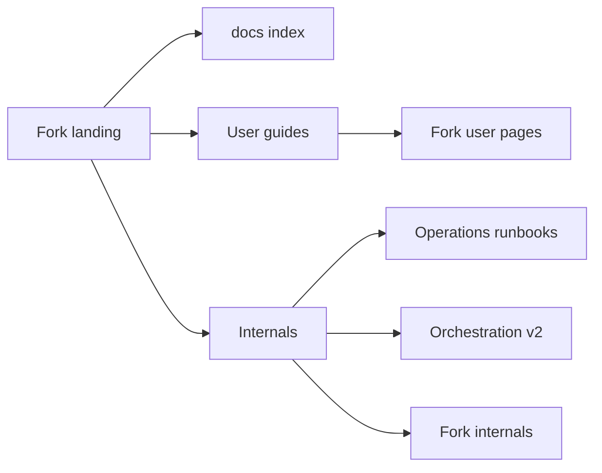

<div align="center">


# ndev.t3code

**An unofficial, personal fork of [T3 Code](https://github.com/pingdotgg/t3code) with extra add-ons for the desktop app.**

[](https://github.com/pingdotgg/t3code)
[](#upstream-sync)
[](#build-it-yourself)
[](https://github.com/travisjneuman/t3code/blob/main/LICENSE)

[What's added](#whats-added) · [Build it yourself](#build-it-yourself) · [Upstream source](https://github.com/pingdotgg/t3code)

</div>

---

Everything T3 Code does comes from the official project at **[pingdotgg/t3code](https://github.com/pingdotgg/t3code)**. Go there to learn about T3 Code itself, its providers, the mobile app and contributing.

This fork follows the upstream nightly and adds the features below. Each add-on lives in its own files, and upstream files get only one-line hooks marked `Fork add-on`. That keeps merges from upstream small ([how the fork is built](https://github.com/travisjneuman/t3code/blob/main/docs/internals/fork-add-ons.md)).

## What's added

| Add-on                                        | What it does                                                            |
| --------------------------------------------- | ----------------------------------------------------------------------- |
| [**Web apps**](#web-apps)                     | ChatGPT, Claude, Grok, Gemini and Perplexity as tabs in the desktop app |
| [**Other Agents**](#other-agents)             | Follow and continue sessions you started in other agent apps            |
| [**Hermes Agent**](#hermes-agent)             | Chat with a Hermes Agent running on this or another computer            |
| [**Compare agents**](#compare-agents)         | One prompt, two models, side by side                                    |
| [**Agent instructions**](#agent-instructions) | Delegation and agent rules as settings, globally or per project         |
| [**Save to notes**](#save-to-notes)           | Files a thread into your notes folder or Obsidian vault                 |
| [**Export a thread**](#export-a-thread)       | Saves a thread's full record as Markdown or JSON                        |
| [**Session details**](#session-details)       | Model, context breakdown, MCP servers and changed files of a session    |
| [**Upstream sync**](#upstream-sync)           | Merges new official nightlies and rebuilds the app from source          |
| [**Compact cards**](#compact-cards)           | Outlined sidebar cards in smaller text, about 23% shorter               |

### Web apps

Open ChatGPT, Claude, Grok, Gemini and Perplexity from the titlebar switcher, right beside T3 Code.

- Each site shows up when its provider is on: ChatGPT with Codex, Claude with Claude, Grok with Grok Build, and Gemini with Antigravity. Perplexity has its own switch.
- Sites follow T3's theme and sidebar width, stay loaded in the background, and show a dot when a reply finishes.
- Text moves both ways. Right-click a selection and choose **Send to T3 Thread**, or send a finished T3 reply into a site's message box.
- Downloaded text files can be added to your draft. ChatGPT and Claude data exports can be turned into Markdown files.

[Guide →](https://github.com/travisjneuman/t3code/blob/main/docs/user/desktop-remote-apps.md)

### Other Agents

Claude Code, Codex, Grok, Pi and Antigravity sessions that you started outside T3 are listed under **Other Agents** in the sidebar. That covers sessions from a terminal, a desktop app or an IDE.

- Each session is one line: harness icon, title and age. Hover one for its folder, model and machine.
- Running sessions stay on top, even with the list collapsed. The last day's sessions follow, then an Earlier group.
- Follow any session live, or find one through the command palette search.
- **Continue in T3** turns a session into a normal thread with its whole history. The original session stays usable in its own app.
- **Hand back to** gives the session back to the agent it came from. **Move back to Other Agents** undoes the continue.
- Sessions from the Claude desktop app and the Codex app can be opened in those apps, and any session can be archived in T3 without touching the original app.

[Guide →](https://github.com/travisjneuman/t3code/blob/main/docs/user/other-agents.md)

### Hermes Agent

Talk to a [Hermes Agent](https://github.com/NousResearch/hermes-agent) from T3 over its API, whether it runs here or on another computer. Its chat platforms, cron jobs and CLI keep working.

- Sessions have their own **Hermes Agent** section above Other Agents: your T3 threads and Hermes's own sessions, newest first. Pin the ones you want on top.
- A session started elsewhere opens in full, tool calls and reasoning included, and a cron job's session ends with the report it delivered to Discord or wherever it went.
- Start one from the section's **+**, or pick Hermes Agent in any new thread's model picker.
- Pick any model Hermes can use, per turn, from collapsible provider groups in the usual model picker. Providers whose terms rule out use from another app are never offered.
- Archive, unarchive and delete reach Hermes too. Hermes's config, keys and custom endpoints are editable in Settings.

[Guide →](https://github.com/travisjneuman/t3code/blob/main/docs/user/hermes.md)

### Compare agents

Send one prompt to two models and read their answers side by side.

- By default each side gets its own empty folder. You can also have both work in the same project.
- Follow-ups go to both sides. Each side keeps its own model, options and attachments.
- **Review swap** shows each agent the other's answer and asks for its best one.
- Pin, rename, archive or delete a comparison just like a thread. These actions are in its header, on the start page and in the command palette.

[Guide →](https://github.com/travisjneuman/t3code/blob/main/docs/user/compare-agents.md)

### Agent instructions

Set how agents work in **Settings → General → Agents**, for all projects or one project at a time, without editing `~/.claude` or `~/.codex`.

- **Delegation** turns on orchestrator rules: the thread's agent hands work to workers with `delegate_task` when useful, or always.
- Pick the **worker model** (for example GPT-6.1 Sol through Pi) and separate **review** and **research** models; T3 uses them whenever an agent leaves out a target.
- Cap **parallel workers**, block workers from delegating, give each worker its own **worktree**, set a **worker time limit**, and set **review rounds**, **read-only reviewers**, and whether the orchestrator **handles git**. T3 enforces the cap, the delegation block, worktrees, and time limits.
- **Block native subagents** so agents use only T3 workers; T3 turns Claude's and Codex's own subagents off.
- Choose how agents **verify**, when they **commit and push**, what they **ask** you first, and how they **report**, then **Preview** exactly what agents receive.
- **Presets** (Solo, Orchestrator, Review-heavy, or your own) apply in one click, and the composer picks a preset for a single thread.
- **Additional instructions** and **provider instructions** take any other rules. Agents follow all of it over conflicting `CLAUDE.md` or `AGENTS.md` rules.
- Works with Claude, Codex, Pi, Grok, Cursor and OpenCode.

[Guide →](https://github.com/travisjneuman/t3code/blob/main/docs/user/agent-instructions.md)

### Save to notes

Choose **Save to notes…** in a thread's menu.

- **Summary**: the agent writes a summary note into your notes folder, following that folder's `AGENTS.md` or `CLAUDE.md` rules.
- **Full copy**: saves the thread's prompts and final answers as one Markdown file.

[Guide →](https://github.com/travisjneuman/t3code/blob/main/docs/user/save-and-export-threads.md#save-a-thread-to-your-notes)

### Export a thread

Choose **Export…** in a thread's menu to save everything the server stores for that thread, including every run, message, tool call, file change and plan. Pick a readable Markdown transcript or a complete JSON record.

[Guide →](https://github.com/travisjneuman/t3code/blob/main/docs/user/save-and-export-threads.md#export-a-thread)

### Session details

The thread details card (`mod+shift+b`) shows what the agent's session is doing, like Claude Desktop's session sidebar.

- **Session**: provider, model, live status, permission mode, turns, and cost when reported.
- **Context**: how full the window is. Claude threads break it down by category, with the MCP tools, memory files, skills and custom agents in context, and a Compact context button.
- **Connectors**: the MCP servers Claude, Codex or OpenCode loaded, with status and tool counts.
- Every titled section collapses from its heading and stays that way across threads.
- **Outputs**: files the thread changed; each opens its diff.

[Guide →](https://github.com/travisjneuman/t3code/blob/main/docs/user/session-details.md)

### Upstream sync

A Mac app you build yourself updates from the checkout it was built from instead of a download feed.

- Every 30 minutes the app merges any new official nightly into the checkout's `main`.
- **Sync & Build** builds the merged source on your Mac. **Restart & Install** then swaps in the new app.
- When needed, Claude Code fixes merge conflicts and build breaks. Nothing is committed unless the build succeeds.
- The merge is pushed to your fork (`origin`) when you can write to it, and never to the official repository. Without write access, the merge and build still finish locally.

[Guide →](https://github.com/travisjneuman/t3code/blob/main/docs/user/fork-updating.md#update-from-source)

### Compact cards

Thread cards in the sidebar keep their three lines (project, title, branch) one text size smaller, with a thin outline and tighter spacing, so more threads fit on screen.

## Build it yourself

You need macOS, [Vite+](https://viteplus.dev/guide/) (`vp`) and at least one [signed-in provider](https://github.com/pingdotgg/t3code#installation).

```bash
git clone https://github.com/travisjneuman/t3code.git
cd t3code
vp i
vp run dist:desktop:dmg:arm64   # on an Intel Mac, use dist:desktop:dmg:x64
```

The app is saved in `release/`. Keep the checkout where it is: the installed app updates from the folder it was built from.

For those updates, add the official repository as `upstream`. Point `origin` at your own fork if you want the merges pushed there.

```bash
git remote add upstream https://github.com/pingdotgg/t3code.git
```

[Guide →](https://github.com/travisjneuman/t3code/blob/main/docs/user/fork-updating.md)

## Documentation map

Fork-specific docs, plus the fork's two front doors that list every user guide and internals note. Everything else in [`docs/`](https://github.com/travisjneuman/t3code/blob/main/docs/README.md) is upstream T3 Code documentation.

| Need / keywords                                   | Open                                                                                                                                                                                                                                                                                                  |
| ------------------------------------------------- | ----------------------------------------------------------------------------------------------------------------------------------------------------------------------------------------------------------------------------------------------------------------------------------------------------- |
| Every user guide by task                          | [User guides](https://github.com/travisjneuman/t3code/blob/main/docs/user/README.md)                                                                                                                                                                                                                  |
| Every internals note, maintainer runbooks         | [Internals](https://github.com/travisjneuman/t3code/blob/main/docs/internals/README.md)                                                                                                                                                                                                               |
| Web apps tabs: ChatGPT, Claude, Grok, Gemini      | [User guide](https://github.com/travisjneuman/t3code/blob/main/docs/user/desktop-remote-apps.md) · [internals](https://github.com/travisjneuman/t3code/blob/main/docs/internals/remote-apps.md)                                                                                                       |
| Other Agents, continue or hand back a session     | [User guide](https://github.com/travisjneuman/t3code/blob/main/docs/user/other-agents.md) · [internals](https://github.com/travisjneuman/t3code/blob/main/docs/internals/external-sessions.md) · [session search](https://github.com/travisjneuman/t3code/blob/main/docs/internals/session-search.md) |
| Hermes Agent, remote agent sessions               | [User guide](https://github.com/travisjneuman/t3code/blob/main/docs/user/hermes.md) · [internals](https://github.com/travisjneuman/t3code/blob/main/docs/internals/hermes.md)                                                                                                                         |
| Compare agents, review swap                       | [User guide](https://github.com/travisjneuman/t3code/blob/main/docs/user/compare-agents.md)                                                                                                                                                                                                           |
| Delegation, worker models, presets                | [Agent instructions](https://github.com/travisjneuman/t3code/blob/main/docs/user/agent-instructions.md)                                                                                                                                                                                               |
| Save to notes, export Markdown or JSON            | [Save and export threads](https://github.com/travisjneuman/t3code/blob/main/docs/user/save-and-export-threads.md)                                                                                                                                                                                     |
| Session details, context breakdown, MCP servers   | [User guide](https://github.com/travisjneuman/t3code/blob/main/docs/user/session-details.md) · [internals](https://github.com/travisjneuman/t3code/blob/main/docs/internals/session-insights.md)                                                                                                      |
| Upstream sync, Sync & Build, build from source    | [Fork updating](https://github.com/travisjneuman/t3code/blob/main/docs/user/fork-updating.md) · [internals](https://github.com/travisjneuman/t3code/blob/main/docs/internals/local-source-updates.md)                                                                                                 |
| How the fork stays mergeable, `Fork add-on` hooks | [Fork add-ons](https://github.com/travisjneuman/t3code/blob/main/docs/internals/fork-add-ons.md)                                                                                                                                                                                                      |
| Upstream features that behave differently here    | [Fork behavior](https://github.com/travisjneuman/t3code/blob/main/docs/user/fork-behavior.md)                                                                                                                                                                                                         |



---

<div align="center">
<sub>
Add-ons by <a href="https://github.com/travisjneuman">Travis J. Neuman</a>. Not affiliated with T3 Tools or Ping.
T3 Code is © T3 Tools Inc. and <a href="https://github.com/travisjneuman/t3code/blob/main/LICENSE">MIT licensed</a>.
</sub>
</div>
