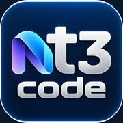
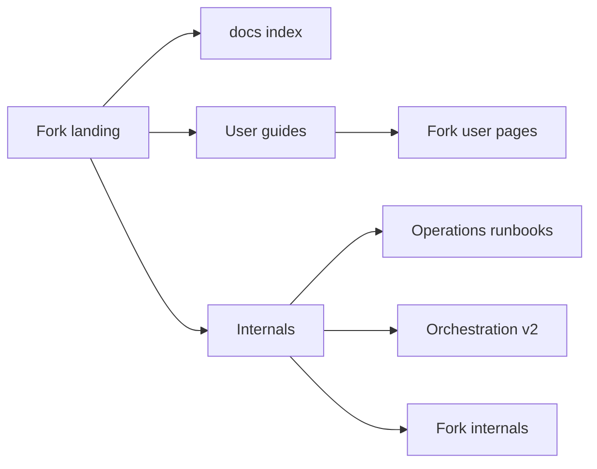

<div align="center">



# ndev.t3code

**An unofficial, personal fork of [T3 Code](https://github.com/pingdotgg/t3code) with extra add-ons for the desktop app.**

[](https://github.com/pingdotgg/t3code)
[](#upstream-sync)
[](#build-it-yourself)
[](https://github.com/travisjneuman/t3code/blob/main/LICENSE)

[What's added](#whats-added) · [Every add-on](#every-add-on) · [Build it yourself](#build-it-yourself) · [Upstream source](https://github.com/pingdotgg/t3code)

</div>

---

Everything T3 Code does comes from the official project at **[pingdotgg/t3code](https://github.com/pingdotgg/t3code)**. Go there to learn about T3 Code itself, its providers, the mobile app and contributing.

This fork follows the upstream nightly and adds the features below. Each add-on lives in its own files, and upstream files get only one-line hooks marked `Fork add-on(<id>)`, listed in [`fork/addons.json`](https://github.com/travisjneuman/t3code/blob/main/fork/addons.json). That keeps merges from upstream small ([how the fork is built](https://github.com/travisjneuman/t3code/blob/main/docs/internals/fork-add-ons.md)).

## What's added

| Add-on                                        | What it does                                                            |
| --------------------------------------------- | ----------------------------------------------------------------------- |
| [**Web apps**](#web-apps)                     | ChatGPT, Claude, Grok, Gemini and Perplexity as tabs in the desktop app |
| [**Other Agents**](#other-agents)             | Follow and continue sessions you started in other agent apps            |
| [**Hermes Agent**](#hermes-agent)             | Chat with a Hermes Agent running on this or another computer            |
| [**Compare agents**](#compare-agents)         | One prompt, two models, side by side                                    |
| [**Agent instructions**](#agent-instructions) | Delegation and agent rules as settings, globally or per project         |
| [**Save to notes**](#save-to-notes)           | Files a thread into your notes folder or Obsidian vault                 |
| [**Export a thread**](#export-a-thread)       | Saves a thread's full record as Markdown or JSON                        |
| [**Session details**](#session-details)       | Model, context breakdown, MCP servers and changed files of any session  |
| [**Upstream sync**](#upstream-sync)           | Merges new official nightlies and rebuilds the app from source          |
| [**Compact cards**](#compact-cards)           | Outlined sidebar cards in smaller text, about 23% shorter               |

### Web apps

Open ChatGPT, Claude, Grok, Gemini and Perplexity from the titlebar switcher, right beside T3 Code.

- Each site shows up when its provider is on: ChatGPT with Codex, Claude with Claude, Grok with Grok Build, and Gemini with Antigravity. Perplexity has its own switch.
- Sites follow T3's theme and sidebar width, stay loaded in the background, and show a dot when a reply finishes.
- Text moves both ways. Right-click a selection and choose **Send to T3 Thread**, or send a finished T3 reply into a site's message box.
- Downloaded text files can be added to your draft. ChatGPT and Claude data exports can be turned into Markdown files.

[Guide →](https://github.com/travisjneuman/t3code/blob/main/docs/user/desktop-remote-apps.md)

### Other Agents

Claude Code, Codex, Grok, Pi and Antigravity sessions that you started outside T3 are listed under **Other Agents** in the sidebar. That covers sessions from a terminal, a desktop app or an IDE.

- Each session is one line: harness icon, title and age. Hover one for its folder, model and machine.
- Running sessions stay on top, even with the list collapsed. Expanded, it shows the last 3 days' sessions; **Load more** adds 10 more at a time.
- Follow any session live, or find one through the command palette search.
- **Continue in T3** turns a session into a normal thread with its whole history. The original session stays usable in its own app.
- **Hand back to** gives the session back to the agent it came from. **Move back to Other Agents** undoes the continue.
- Sessions from the Claude desktop app and the Codex app can be opened in those apps, and any session can be archived in T3 without touching the original app.

[Guide →](https://github.com/travisjneuman/t3code/blob/main/docs/user/other-agents.md)

### Hermes Agent

Talk to a [Hermes Agent](https://github.com/NousResearch/hermes-agent) from T3 over its API, whether it runs here or on another computer. Its chat platforms, cron jobs and CLI keep working.

- Sessions have their own **Hermes Agent** section above Other Agents: your T3 threads and Hermes's own sessions, newest first. Pin the ones you want on top.
- A session started elsewhere opens in full, tool calls and reasoning included, and a cron job's session ends with the report it delivered to Discord or wherever it went.
- Start one from the section's **+**, or pick Hermes Agent in any new thread's model picker.
- Pick any model Hermes can use, per turn, from collapsible provider groups in the usual model picker. Groups and models carry their vendors' names, such as Codex with GPT-6.1-Sol. Providers whose terms rule out use from another app are never offered.
- Archive, unarchive and delete reach Hermes too. Hermes's config, keys and custom endpoints are editable in Settings.

[Guide →](https://github.com/travisjneuman/t3code/blob/main/docs/user/hermes.md)

### Compare agents

Send one prompt to two models and read their answers side by side.

- By default each side gets its own empty folder. You can also have both work in the same project.
- Follow-ups go to both sides. Each side keeps its own model, options and attachments.
- **Review swap** shows each agent the other's answer and asks for its best one.
- Pin, rename, archive or delete a comparison just like a thread. These actions are in its header, on the start page and in the command palette.

[Guide →](https://github.com/travisjneuman/t3code/blob/main/docs/user/compare-agents.md)

### Agent instructions

Set how agents work in **Settings → General → Agents**, for all projects or one project at a time, without editing `~/.claude` or `~/.codex`.

- **Delegation** turns on orchestrator rules: the thread's agent hands work to workers with `delegate_task` when useful, or always. **Off** (the Solo preset) makes it work alone, and T3 refuses its workers.
- Pick the **worker model** (for example GPT-6.1 Sol through Pi) and separate **review** and **research** models; T3 uses them whenever an agent leaves out a target.
- Cap **parallel workers**, block workers from delegating, give each worker its own **worktree**, set a **worker time limit**, and set **review rounds**, **read-only reviewers**, and whether the orchestrator **handles git**. T3 enforces the cap, the delegation block, worktrees, and time limits.
- **Block native subagents** so agents use only T3 workers; T3 turns Claude's and Codex's own subagents off.
- Choose how agents **verify**, when they **commit and push**, what they **ask** you first, and how they **report**, then **Preview** exactly what agents receive.
- **Presets** (Solo, Orchestrator, Review-heavy, or your own) apply when picked and save back with one click, and the composer picks a preset for a single thread.
- **Additional instructions** and **provider instructions** take any other rules. Agents follow all of it over conflicting `CLAUDE.md` or `AGENTS.md` rules.
- Works with Claude, Codex, Pi, Grok, Cursor and OpenCode.

[Guide →](https://github.com/travisjneuman/t3code/blob/main/docs/user/agent-instructions.md)

### Save to notes

Choose **Save to notes…** in a thread's menu.

- **Summary**: the agent writes a summary note into your notes folder, following that folder's `AGENTS.md` or `CLAUDE.md` rules.
- **Full copy**: saves the thread's prompts and final answers as one Markdown file.

[Guide →](https://github.com/travisjneuman/t3code/blob/main/docs/user/save-and-export-threads.md#save-a-thread-to-your-notes)

### Export a thread

Choose **Export…** in a thread's menu to save everything the server stores for that thread, including every run, message, tool call, file change and plan. Pick a readable Markdown transcript or a complete JSON record.

[Guide →](https://github.com/travisjneuman/t3code/blob/main/docs/user/save-and-export-threads.md#export-a-thread)

### Session details

The thread details card (`mod+shift+b`) shows what the agent's session is doing, like Claude Desktop's session sidebar.

It works the same for T3 threads, Hermes sessions (opened or not) and Other Agents sessions.

- **Session**: provider, model, status, permission and sandbox modes, Remote control, version, turns, messages, tool uses, tokens, cost, and usage limits, whatever the agent records.
- **Context**: how full the window is and how far from auto-compact. Claude threads break it down by category, with the MCP tools, memory files, skills and custom agents in context, and a Compact context button; Claude sessions from Claude Desktop or the CLI get an estimated breakdown against the same window Desktop shows.
- **Connectors**: the MCP servers the agent loaded or is configured with, with status and tool counts.
- Every titled section collapses from its heading and stays that way across threads, and a stopped thread keeps its last report across restarts.
- **Outputs**: files the session changed; in a thread each opens its diff, elsewhere it opens in your editor.

[Guide →](https://github.com/travisjneuman/t3code/blob/main/docs/user/session-details.md)

### Upstream sync

A Mac app you build yourself updates from the checkout it was built from instead of a download feed.

- Every 30 minutes the app merges any new official nightly into the checkout's `main`.
- **Sync & Build** builds the merged source on your Mac. **Restart & Install** then swaps in the new app.
- When needed, Claude Code fixes merge conflicts and build breaks. Build fixes are committed only after a successful build.
- The merge is committed and a push to your fork (`origin`) is attempted before building, so configured fork hosts can build the same commit. It never pushes to the official repository; without write access, the local build can continue. A failed build leaves the merge in place and the installed app unchanged.

[Guide →](https://github.com/travisjneuman/t3code/blob/main/docs/user/fork-updating.md#update-from-source)

### Compact cards

Thread cards in the sidebar keep their three lines (project, title, branch) one text size smaller, with a thin outline and tighter spacing, so more threads fit on screen.

## Every add-on

Every add-on has an id, and each fork line in an upstream file carries `Fork add-on(<id>)`. [`fork/addons.json`](https://github.com/travisjneuman/t3code/blob/main/fork/addons.json) lists each add-on's files, the upstream files it hooks, the data it adds and the add-ons it depends on. Personal add-ons are the owner's own tooling; skip them when adopting add-ons.

| Id                        | Tier         | Add-on                                    | What it does                                                                                                                              |
| ------------------------- | ------------ | ----------------------------------------- | ----------------------------------------------------------------------------------------------------------------------------------------- |
| `core`                    | core         | Fork core                                 | Shared plumbing the add-ons plug into: RPC scope merge, desktop bridge and IPC, fork migrations, menu icons, the fork's docs front doors. |
| `web-apps`                | feature      | [Web apps](#web-apps)                     | ChatGPT, Claude, Grok, Gemini and Perplexity as tabs in the desktop app.                                                                  |
| `other-agents`            | feature      | [Other Agents](#other-agents)             | Follow, continue and hand back sessions started in other agent apps.                                                                      |
| `hermes`                  | feature      | [Hermes Agent](#hermes-agent)             | A Hermes Agent provider, local or remote, with its own sidebar section.                                                                   |
| `compare-agents`          | feature      | [Compare agents](#compare-agents)         | One prompt to two models, side by side, with review swap.                                                                                 |
| `agent-instructions`      | feature      | [Agent instructions](#agent-instructions) | Delegation, worker models and agent rules as settings, globally or per project.                                                           |
| `save-to-notes`           | feature      | [Save to notes](#save-to-notes)           | Files a thread into a notes folder as a summary or a full copy.                                                                           |
| `thread-export`           | feature      | [Export a thread](#export-a-thread)       | Saves a thread's full server record as Markdown or JSON.                                                                                  |
| `session-details`         | feature      | [Session details](#session-details)       | Session, context, connectors and outputs of any session in the thread details card.                                                       |
| `compact-cards`           | feature      | [Compact cards](#compact-cards)           | Outlined, smaller sidebar thread cards that always name their machine.                                                                    |
| `subagent-tree`           | feature      | Subagent tree                             | Subagents nest under their thread in the sidebar and the Lineage panel.                                                                   |
| `session-search`          | feature      | Session search                            | Command palette search across T3 threads and other agents' sessions.                                                                      |
| `maintenance-queue`       | feature      | Maintenance queue                         | Server and provider updates wait in one queue that closes idle sessions first and counts this app.                                        |
| `existing-checkout`       | feature      | Existing checkouts                        | Add a machine's existing checkout instead of cloning, and find checkouts on other machines.                                               |
| `project-links`           | feature      | Project links                             | Link folder projects across machines into one project.                                                                                    |
| `thread-retention`        | feature      | Thread retention                          | Settled and archived threads clean themselves up.                                                                                         |
| `host-backups`            | feature      | Host backups                              | Lists the backups the host tooling keeps on a machine and the version each would restore.                                                 |
| `remote-pairing`          | feature      | Remote pairing                            | Pair a phone with any connected machine.                                                                                                  |
| `usage-by-model`          | feature      | Usage by model                            | Usage shows one row per model across harnesses.                                                                                           |
| `usage-pace`              | feature      | Usage pace                                | Pace for weekly and monthly usage windows.                                                                                                |
| `codex-hidden-models`     | feature      | Codex hidden models                       | A switch that lists the models Codex keeps out of its picker.                                                                             |
| `retired-models`          | feature      | Retired models                            | Threads on a retired model move to its successor.                                                                                         |
| `mcp-hub`                 | feature      | MCP hub                                   | `t3 mcp token` and `t3 mcp stdio` for agents without OAuth.                                                                               |
| `multi-select-menu`       | feature      | Multi-select menu                         | Selected threads get the whole thread menu.                                                                                               |
| `collapsible-details`     | feature      | Collapsible details                       | Thread details sections collapse and remember it.                                                                                         |
| `no-project-start`        | feature      | No-project start                          | New threads start without a project; one No project per machine.                                                                          |
| `status-colors`           | feature      | Status colors                             | Status colors mean the same thing everywhere.                                                                                             |
| `model-brand-names`       | feature      | Model brand names                         | Providers and models carry their vendors' names.                                                                                          |
| `renamed-hosts`           | feature      | Renamed hosts                             | Machines renamed after pairing keep their new name.                                                                                       |
| `tailscale-https`         | feature      | Tailscale HTTPS                           | Connections says when the tailnet has HTTPS certificates turned off.                                                                      |
| `claude-release-channel`  | feature      | Claude release channel                    | Claude updates follow Claude's own release channel.                                                                                       |
| `vpn-lan`                 | fix          | VPN addresses                             | Full-tunnel VPN addresses are not offered as LAN addresses.                                                                               |
| `windows-taskkill`        | fix          | Windows taskkill                          | A Windows taskkill that exits non-zero after every named process is gone counts as success.                                               |
| `stdio-eio`               | fix          | stdio EIO                                 | An EIO on a closed stdout pipe does not crash the desktop app on macOS.                                                                   |
| `bootstrap-retry`         | fix          | Auth bootstrap retry                      | Retries a settling desktop backend's 500 during auth bootstrap.                                                                           |
| `clipboard-focus`         | fix          | Clipboard focus                           | Copying works when the window is unfocused.                                                                                               |
| `route-crash-escape`      | fix          | Route crash escape                        | Leave a crashing route instead of being stuck on it.                                                                                      |
| `grok-zero-usage`         | fix          | Grok zero usage                           | An omitted Grok percentage still shows as 0% used.                                                                                        |
| `telemetry-check-failure` | fix          | Telemetry check failure                   | A failed telemetry endpoint check shows Check failed instead of Not checked.                                                              |
| `scheduled-tasks-error`   | fix          | Scheduled tasks error                     | A failed delivery list shows its error without a stuck loading line.                                                                      |
| `identity`                | distribution | Identity                                  | App id, profile, link scheme and app name, so the fork installs beside official T3 Code.                                                  |
| `ndev-icons`              | distribution | ndev artwork                              | The fork's app and web icons.                                                                                                             |
| `keychain-free-secrets`   | distribution | Keychain-free secrets                     | On macOS, saved connections use a file key, so updates stop asking for the keychain password.                                             |
| `upstream-sync`           | distribution | [Upstream sync](#upstream-sync)           | Merges new upstream nightlies and rebuilds the app from its source checkout.                                                              |
| `host-releases`           | distribution | Host releases                             | Connected hosts run fork builds: release source, HTTPS mirrors, version facts and runtime retention.                                      |
| `tjn-fleet`               | personal     | TJN fleet                                 | Owner's fleet host tooling and workflows; not useful to other people.                                                                     |
| `owner-policy`            | personal     | Owner policy                              | Owner's agent-instruction overrides in AGENTS.md.                                                                                         |

## Build it yourself

You need macOS, [Vite+](https://viteplus.dev/guide/) (`vp`) and at least one [signed-in provider](https://github.com/pingdotgg/t3code#installation).

```bash
git clone https://github.com/travisjneuman/t3code.git
cd t3code
vp i
vp run dist:desktop:dmg:arm64   # on an Intel Mac, use dist:desktop:dmg:x64
```

The app is saved in `release/`. Keep the checkout where it is: the installed app updates from the folder it was built from.

For those updates, add the official repository as `upstream`. Point `origin` at your own fork if you want the merges pushed there.

```bash
git remote add upstream https://github.com/pingdotgg/t3code.git
```

[Guide →](https://github.com/travisjneuman/t3code/blob/main/docs/user/fork-updating.md)

## Documentation map

Fork-specific docs, plus the fork's two front doors that list every user guide and internals note. Everything else in [`docs/`](https://github.com/travisjneuman/t3code/blob/main/docs/README.md) is upstream T3 Code documentation.

| Need / keywords                                   | Open                                                                                                                                                                                                                                                                                                  |
| ------------------------------------------------- | ----------------------------------------------------------------------------------------------------------------------------------------------------------------------------------------------------------------------------------------------------------------------------------------------------- |
| Every user guide by task                          | [User guides](https://github.com/travisjneuman/t3code/blob/main/docs/user/README.md)                                                                                                                                                                                                                  |
| MCP hub, OAuth, header-only and stdio agents       | [MCP hub guide](https://github.com/travisjneuman/t3code/blob/main/docs/user/mcp-hub.md) |
| Every internals note, maintainer runbooks         | [Internals](https://github.com/travisjneuman/t3code/blob/main/docs/internals/README.md)                                                                                                                                                                                                               |
| Web apps tabs: ChatGPT, Claude, Grok, Gemini      | [User guide](https://github.com/travisjneuman/t3code/blob/main/docs/user/desktop-remote-apps.md) · [internals](https://github.com/travisjneuman/t3code/blob/main/docs/internals/remote-apps.md)                                                                                                       |
| Other Agents, continue or hand back a session     | [User guide](https://github.com/travisjneuman/t3code/blob/main/docs/user/other-agents.md) · [internals](https://github.com/travisjneuman/t3code/blob/main/docs/internals/external-sessions.md) · [session search](https://github.com/travisjneuman/t3code/blob/main/docs/internals/session-search.md) |
| Hermes Agent, remote agent sessions               | [User guide](https://github.com/travisjneuman/t3code/blob/main/docs/user/hermes.md) · [internals](https://github.com/travisjneuman/t3code/blob/main/docs/internals/hermes.md)                                                                                                                         |
| Compare agents, review swap                       | [User guide](https://github.com/travisjneuman/t3code/blob/main/docs/user/compare-agents.md)                                                                                                                                                                                                           |
| Delegation, worker models, presets                | [Agent instructions](https://github.com/travisjneuman/t3code/blob/main/docs/user/agent-instructions.md)                                                                                                                                                                                               |
| Save to notes, export Markdown or JSON            | [Save and export threads](https://github.com/travisjneuman/t3code/blob/main/docs/user/save-and-export-threads.md)                                                                                                                                                                                     |
| Session details, context breakdown, MCP servers   | [User guide](https://github.com/travisjneuman/t3code/blob/main/docs/user/session-details.md) · [internals](https://github.com/travisjneuman/t3code/blob/main/docs/internals/session-insights.md)                                                                                                      |
| Upstream sync, Sync & Build, build from source    | [Fork updating](https://github.com/travisjneuman/t3code/blob/main/docs/user/fork-updating.md) · [internals](https://github.com/travisjneuman/t3code/blob/main/docs/internals/local-source-updates.md)                                                                                                 |
| How the fork stays mergeable, `Fork add-on` hooks | [Fork add-ons](https://github.com/travisjneuman/t3code/blob/main/docs/internals/fork-add-ons.md)                                                                                                                                                                                                      |
| Upstream features that behave differently here    | [Fork behavior](https://github.com/travisjneuman/t3code/blob/main/docs/user/fork-behavior.md)                                                                                                                                                                                                         |



---

<div align="center">
<sub>
Add-ons by <a href="https://github.com/travisjneuman">Travis J. Neuman</a>. Not affiliated with T3 Tools or Ping.
T3 Code is © T3 Tools Inc. and <a href="https://github.com/travisjneuman/t3code/blob/main/LICENSE">MIT licensed</a>.
</sub>
</div>
