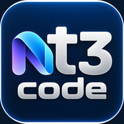

<div align="center">



# ndev.t3code

**An unofficial fork of [T3 Code](https://github.com/pingdotgg/t3code) that follows the upstream nightly and adds its own features as separable add-ons.**

[](https://github.com/pingdotgg/t3code)
[](#relationship-to-upstream)
[](#build-install-and-update)
[](https://github.com/travisjneuman/t3code/blob/main/LICENSE)

[Upstream](#relationship-to-upstream) · [What's added](#whats-added) · [How it's built](#how-the-fork-is-built) · [Every add-on](#every-add-on) · [Build and update](#build-install-and-update) · [What stays upstream's](#what-stays-upstreams) · [Docs](#documentation-map)

</div>

---

ndev.t3code is T3 Code from **[pingdotgg/t3code](https://github.com/pingdotgg/t3code)** plus a set of add-ons, mostly for the desktop app. It is a personal fork, shared as-is. It is not affiliated with, endorsed by, or supported by T3 Tools Inc., Ping, or the T3 Code maintainers.

Everything T3 Code itself does (providers, threads, the composer, remote access, T3 Connect, the mobile app) comes from upstream unchanged, except where this page or [Fork behavior](https://github.com/travisjneuman/t3code/blob/main/docs/user/fork-behavior.md) says otherwise. To learn T3 Code itself, start at the [official project](https://github.com/pingdotgg/t3code).

## Relationship to upstream

**The fork follows upstream all the time.** Its `main` is upstream's code with the add-ons merged in, never a rewrite of it. The fork's desktop app checks for a new upstream nightly a minute after it starts and every 30 minutes after that, and merges it into the checkout's `main`. A sync button merges upstream's `main` directly, including changes that aren't in a nightly yet. In practice the fork takes several upstream merges a day, recorded as `chore(sync): merge upstream nightly …` and `chore(sync): merge upstream main …` commits.

**Changes go one way.** The fork only fetches from upstream. It never pushes to the official repository and never opens pull requests or issues there, and fork changes are not offered upstream. The update code refuses to run when `origin` points at the official repository, so a merge can only be pushed to a fork.

What that means for you:

- **Support.** The T3 Code maintainers don't support this fork, and the fork has no issue tracker. Before reporting a problem to upstream, reproduce it in official T3 Code; never report a fork add-on's behavior there.
- **Docs.** Upstream's documentation in [`docs/`](https://github.com/travisjneuman/t3code/blob/main/docs/README.md) and the root `README.md` are kept identical to upstream and apply to the fork as written. Fork pages are separate files, marked _Fork add-on_. Where the fork changes an upstream feature, [Fork behavior](https://github.com/travisjneuman/t3code/blob/main/docs/user/fork-behavior.md) says how, instead of the upstream guide being edited.
- **Versions.** A fork build carries the version of the upstream nightly it merged. **Settings → About** lists the fork add-ons the connected server was built with as **Fork add-ons**; an official server shows no such row.
- **Lag.** A new upstream feature reaches the fork at the next merge and build. A merge that conflicts with an add-on waits until a repair agent or the owner settles it.

## What's added

| Add-on                                        | What it does                                                               |
| --------------------------------------------- | -------------------------------------------------------------------------- |
| [**Web apps**](#web-apps)                     | ChatGPT, Claude, Grok, Gemini and Perplexity as tabs in the desktop app    |
| [**Other Agents**](#other-agents)             | Follow, continue and hand back sessions you started in other agent apps    |
| [**Hermes Agent**](#hermes-agent)             | Chat with a Hermes Agent running on this or another computer               |
| [**OpenBot**](#openbot)                       | Chat with OpenBot agents and follow all their conversations                |
| [**Compare agents**](#compare-agents)         | One prompt, two models, side by side                                       |
| [**Agent instructions**](#agent-instructions) | Delegation, worker models, worker balancing and agent rules as settings    |
| [**Save to notes**](#save-to-notes)           | Files a thread into your notes folder or Obsidian vault                    |
| [**Export a thread**](#export-a-thread)       | Saves a thread's full record as Markdown or JSON                           |
| [**Session details**](#session-details)       | Model, context breakdown, MCP servers and changed files of any session     |
| [**MCP hub**](#mcp-hub)                       | Connects MCP agents that can't sign in with OAuth                          |
| [**Upstream sync**](#upstream-sync)           | Merges new official nightlies and rebuilds the app from source             |
| [**Compact cards**](#compact-cards)           | Outlined sidebar cards in smaller text, about 23% shorter                  |
| [**Smaller changes**](#smaller-changes)       | Projects across machines, sidebar, providers, usage, maintenance and fixes |

### Web apps

Open ChatGPT, Claude, Grok, Gemini and Perplexity from the titlebar switcher, right beside T3 Code.

- Each site shows up when its provider is on: ChatGPT with Codex, Claude with Claude, Grok with Grok, and Gemini with Antigravity. Perplexity has its own switch.
- Each site keeps its own sign-in, follows T3's theme and sidebar width, stays loaded while you switch away (an idle site unloads after 4 hours by default), and shows a dot when a reply finishes.
- Any site also opens in the right panel beside a thread.
- Text moves both ways. Right-click a selection and choose **Send to T3 Thread**, or send a finished T3 reply into a site's message box.
- Downloaded text files can be added to your draft. ChatGPT and Claude data exports can be turned into Markdown files.

[Guide →](https://github.com/travisjneuman/t3code/blob/main/docs/user/desktop-remote-apps.md)

### Other Agents

Claude Code, Codex, Grok, Pi and Antigravity sessions that you started outside T3, from a terminal, a desktop app or an IDE, are listed under **Other Agents** in the sidebar.

- Each session is one line: harness icon, title and age. Hover one for its folder, model and machine.
- Running sessions stay on top, even with the list collapsed. Expanded, it shows the last 3 days' sessions; **Load more** adds 10 more at a time. In an open session, **Load more** brings in earlier messages.
- Follow any session live, or find one through the command palette, which also searches other agents' messages.
- **Continue in T3** turns a session into a normal thread with its history; the agent resumes the whole session. The original session stays usable in its own app.
- **Hand back to** gives the session back to the agent it came from. **Move back to Other Agents** undoes the continue.
- Sessions from the Claude desktop app and the Codex app can be opened in those apps, and any session can be archived in T3 without touching the original app.

[Guide →](https://github.com/travisjneuman/t3code/blob/main/docs/user/other-agents.md)

### Hermes Agent

Talk to a [Hermes Agent](https://github.com/NousResearch/hermes-agent) from T3 over its API, whether it runs here or on another computer. Its chat platforms, cron jobs and CLI keep working.

- Sessions have their own section above Other Agents, named after the agent: your T3 threads and Hermes's own sessions, newest first. Pin the ones you want on top.
- A session started elsewhere opens in full, tool calls and reasoning included, and a cron job's session ends with the report it delivered to Discord or wherever it went.
- Start one from the section's **+**, or pick Hermes Agent in any new thread's model picker.
- Pick any model Hermes can use, per turn, from collapsible provider groups in the usual model picker. Groups and models carry their vendors' names, such as Codex with GPT-6.1-Sol. Providers whose terms rule out use from another app are never offered.
- Archive, unarchive and delete reach Hermes too. Hermes's config, keys and custom endpoints are editable in Settings.

[Guide →](https://github.com/travisjneuman/t3code/blob/main/docs/user/hermes.md)

### OpenBot

Chat with your OpenBot agents from T3, on OpenBot's machine or over SSH from another one, and follow every conversation they hold, side threads included.

- Each OpenBot gets its own sidebar section above Other Agents, named after the provider or the host it reaches. Agents show as "Name - Role", with their side threads nested under them. Click one to open it with its history.
- **+** starts a message to your default agent, and the composer's agent picker switches to another. T3 sends only to an agent's main conversation, and only when the agent has Local scripts on; side threads are read-only.
- The model picker moves an agent to another provider and model OpenBot already uses. OpenBot's token use and cost show on the Usage page.

[Guide →](https://github.com/travisjneuman/t3code/blob/main/docs/user/openbot.md)

### Compare agents

Send one prompt to two models and read their answers side by side.

- By default each side gets its own empty folder. You can also have both work in the same project.
- Follow-ups go to both sides. Each side keeps its own model, options and attachments.
- **Review swap** shows each agent the other's answer and asks for its best one.
- Pin, rename, archive or delete a comparison just like a thread. These actions are in its header, on the start page and in the command palette.

[Guide →](https://github.com/travisjneuman/t3code/blob/main/docs/user/compare-agents.md)

### Agent instructions

Set how agents work in **Settings → Threads**, in the Agents section, for all projects or one project at a time, without editing `~/.claude` or `~/.codex`.

- **Delegation** turns on orchestrator rules: the thread's agent hands work to workers with `delegate_task` when useful, or always. **Off (work alone)**, as in the Solo preset, makes it work alone, and T3 refuses its workers.
- Pick the **worker model** and separate **review** and **research** models; T3 uses them whenever an agent leaves out a target. **Fixed worker targets** makes T3 reject any other target.
- **Balance workers** spreads untargeted workers over two or more models by how far each subscription is ahead of its weekly pace, skipping any at a usage limit. **Main agent reserve** stops workers from using the thread agent's own subscription once its week runs low.
- Cap **parallel workers**, set the **delegation depth**, give each worker its own **worktree**, set a **worker time limit**, and set **review rounds**, **read-only reviewers**, and whether the orchestrator **handles git**. T3 enforces the cap, the depth, worktrees, and time limits.
- **Block native subagents** so agents use only T3 workers; T3 turns Claude's and Codex's own subagents off.
- Choose how agents **verify**, when they **commit and push**, what they **ask** you first, and how they **report**, then **Preview** exactly what agents receive.
- **Presets** (Solo, Orchestrator, Review-heavy, or your own) apply when picked and save back with one click, and the composer picks a preset for a single thread.
- **Additional instructions** and **provider instructions** take any other rules. Agents follow all of it over conflicting `CLAUDE.md` or `AGENTS.md` rules.
- Works with Claude, Codex, Pi, Grok, Cursor, Muse, OpenCode, Kiro, fx, Hermes Agent and agents added from the ACP Registry. Antigravity doesn't receive agent instructions, and OpenBot agents follow OpenBot's own rules.

[Guide →](https://github.com/travisjneuman/t3code/blob/main/docs/user/agent-instructions.md)

### Save to notes

Choose **Save to notes…** in a thread's menu.

- **Summary**: the agent writes a summary note into your notes folder, following that folder's `AGENTS.md` or `CLAUDE.md` rules.
- **Full copy**: saves the thread's prompts and final answers as one Markdown file.

[Guide →](https://github.com/travisjneuman/t3code/blob/main/docs/user/save-and-export-threads.md#save-a-thread-to-your-notes)

### Export a thread

Choose **Export…** in a thread's menu to save everything the server stores for that thread, including every run, message, tool call, file change and plan. Pick a readable Markdown transcript or a complete JSON record.

[Guide →](https://github.com/travisjneuman/t3code/blob/main/docs/user/save-and-export-threads.md#export-a-thread)

### Session details

The thread details card (`mod+shift+b`) shows what the agent's session is doing, like Claude Desktop's session sidebar. It works the same for T3 threads, Hermes sessions (opened or not) and Other Agents sessions.

- **Session**: provider, model, status, permission and sandbox modes, Remote control, version, turns, messages, tool uses, tokens, cost, and usage limits, whatever the agent records.
- **Context**: how full the window is and how far from auto-compact. Claude threads break it down by category, with the MCP tools, memory files, skills and custom agents in context, and a Compact context button; Claude sessions from Claude Desktop or the CLI get an estimated breakdown against the same window Desktop shows.
- **Connectors**: the MCP servers the agent loaded or is configured with, with status and tool counts.
- **Outputs**: files the session changed; in a thread each opens its diff, elsewhere it opens in your editor.
- Every titled section collapses from its heading and stays that way across threads, and a stopped thread keeps its last report across restarts.

[Guide →](https://github.com/travisjneuman/t3code/blob/main/docs/user/session-details.md)

### MCP hub

Upstream connects outside agents to T3's MCP server with OAuth. The fork adds two commands for agents that can't do OAuth: `t3 mcp token` prints a bearer token for agents that accept a URL and a header, and `t3 mcp stdio` bridges stdio-only agents. Tokens get the same access choices and revocation in **Sharing & access** as OAuth sign-ins.

[Guide →](https://github.com/travisjneuman/t3code/blob/main/docs/user/mcp-hub.md)

### Upstream sync

A Mac app you build yourself updates from the checkout it was built from instead of a download feed.

- Every 30 minutes the app merges any new official nightly into the checkout's `main`. **Sync fork with official T3 Code** merges upstream's `main` on demand.
- **Sync & Build** builds the merged source on your Mac. **Restart & Install** then swaps in the new app.
- Merge conflicts and build breaks go to a **repair agent**: Pi on API keys first, then Claude Code by default, set in **Settings → Maintenance**. The background check never uses one; it skips a conflicting nightly until a newer one lands or you merge by hand. Build fixes are committed only after a successful build.
- The merge is committed and a push to your fork (`origin`) is attempted before building, so other machines can build the same commit. It never pushes to the official repository; without write access, the local build continues. A failed build leaves the merge in place and the installed app unchanged.
- The app's restart into a new version waits for sessions running on this machine ([updates run at once](https://github.com/travisjneuman/t3code/blob/main/docs/user/fork-updating.md#updates-run-at-once) has the rest).

[Guide →](https://github.com/travisjneuman/t3code/blob/main/docs/user/fork-updating.md#update-from-source)

### Compact cards

Thread cards in the sidebar keep their three lines (project, title, branch) one text size smaller, with a thin outline and tighter spacing, so more threads fit on screen: 60 pixels tall instead of 78. Every card names its machine.

### Smaller changes

Each of these is its own add-on, described in [Fork behavior](https://github.com/travisjneuman/t3code/blob/main/docs/user/fork-behavior.md) unless another guide is linked.

**Threads and the sidebar**

- New threads start [without a project](https://github.com/travisjneuman/t3code/blob/main/docs/user/fork-behavior.md#new-threads-start-without-a-project), or in a default project you choose per device in **Settings → Projects**.
- [Subagents nest under their thread](https://github.com/travisjneuman/t3code/blob/main/docs/user/fork-behavior.md#subagents-sit-under-their-thread) in the sidebar and the Lineage panel.
- [Several selected threads get the whole thread menu](https://github.com/travisjneuman/t3code/blob/main/docs/user/fork-behavior.md#selected-threads-get-the-whole-thread-menu).
- [Settled and archived threads clean themselves up](https://github.com/travisjneuman/t3code/blob/main/docs/user/fork-behavior.md#settled-and-archived-threads-clean-themselves-up) after the times you set.
- [Thread details sections collapse](https://github.com/travisjneuman/t3code/blob/main/docs/user/fork-behavior.md#thread-details-sections-collapse) and remember it.
- [Status colors mean the same thing everywhere](https://github.com/travisjneuman/t3code/blob/main/docs/user/fork-behavior.md#status-colors-mean-the-same-thing-everywhere).

**Projects and machines**

- [One project on several machines](https://github.com/travisjneuman/t3code/blob/main/docs/user/fork-behavior.md#one-project-on-several-machines): add a machine's existing checkout instead of cloning, find checkouts on other machines, link folder projects into one project, and show a project's icon on every machine.
- [Renamed machines keep their new name](https://github.com/travisjneuman/t3code/blob/main/docs/user/fork-behavior.md#renamed-machines-keep-their-new-name).
- [Pair a phone with any connected machine](https://github.com/travisjneuman/t3code/blob/main/docs/user/fork-behavior.md#pair-a-phone-with-any-connected-machine) from its row menu.
- [Connected fork hosts follow the desktop app's local builds](https://github.com/travisjneuman/t3code/blob/main/docs/user/fork-behavior.md#connected-fork-hosts-follow-the-desktop-apps-local-builds), [host services keep one executable path](https://github.com/travisjneuman/t3code/blob/main/docs/user/fork-behavior.md#host-services-keep-one-executable-path) across updates, and a host's **Backups…** item lists the backups it keeps and the version each would restore.
- [Actions a connection can't run are hidden](https://github.com/travisjneuman/t3code/blob/main/docs/user/fork-behavior.md#actions-a-connection-cant-run-are-hidden) when it was paired with limited access.
- [Sessions and links last ten years](https://github.com/travisjneuman/t3code/blob/main/docs/user/fork-behavior.md#sessions-and-links-last-ten-years) by default instead of 30 days, set in **Settings → Maintenance**.
- [Tailscale HTTPS](https://github.com/travisjneuman/t3code/blob/main/docs/user/fork-behavior.md#tailscale-https-needs-https-certificates) says when the tailnet has HTTPS certificates off, and [full-tunnel VPN addresses](https://github.com/travisjneuman/t3code/blob/main/docs/user/fork-behavior.md#full-tunnel-vpn-addresses-arent-offered-as-lan-addresses) aren't offered as LAN addresses.

**Providers and models**

- [All environments in Settings → Providers](https://github.com/travisjneuman/t3code/blob/main/docs/user/fork-behavior.md#all-environments-in-settings--providers) applies a provider change on every connected machine that has the provider.
- [Built-in providers other than Codex and Claude can be removed](https://github.com/travisjneuman/t3code/blob/main/docs/user/fork-behavior.md#built-in-providers-can-be-removed-from-the-list) from the list.
- [Codex can show its hidden models](https://github.com/travisjneuman/t3code/blob/main/docs/user/fork-behavior.md#codex-can-show-hidden-models), [model names match the vendor's](https://github.com/travisjneuman/t3code/blob/main/docs/user/fork-behavior.md#pi-model-names-match-the-vendors), and [threads on a retired model move to its successor](https://github.com/travisjneuman/t3code/blob/main/docs/user/fork-behavior.md#retired-models-move-to-their-successor).
- [A wrapper script can name the install it runs](https://github.com/travisjneuman/t3code/blob/main/docs/user/fork-behavior.md#wrapper-scripts-can-name-the-install-they-run), so provider updates reach it.

**Usage and maintenance**

- [Usage shows one row per model](https://github.com/travisjneuman/t3code/blob/main/docs/user/fork-behavior.md#usage-shows-one-row-per-model) across harnesses, and [weekly and monthly limits get a pace](https://github.com/travisjneuman/t3code/blob/main/docs/user/fork-behavior.md#usage-pace-for-weekly-and-monthly-limits).
- [Updates run at once](https://github.com/travisjneuman/t3code/blob/main/docs/user/fork-updating.md#updates-run-at-once) through one queue. Only two wait for this machine's work: the app's own restart waits for running sessions, and a provider update closes its idle sessions first and waits only for a turn in progress.

**Fixes to upstream code**

Twelve small fixes that upstream doesn't have, from Windows `taskkill` exit codes to copying while the window is unfocused. Each is a `fix` row in the [add-on table](#every-add-on).

## How the fork is built

Every upstream merge costs less the less the fork touches upstream files, so the fork is shaped like a set of plug-ins rather than a patch set. The goal is that every fork feature is an add-on that can be told apart, counted, and left out, and that a missing add-on leaves upstream's own behavior in its place.

- **Fork-owned files.** Add-on code lives in files that don't exist upstream, so upstream merges never conflict with them.
- **One-line hooks.** Where an add-on must reach into an upstream file, it adds a hook at a stable point: an import, a spread into a list, a mount, one call. Every fork line in an upstream file carries `Fork add-on(<id>)` naming its add-on, so `git grep -n "Fork add-on("` lists the whole footprint.
- **Extension points.** Where several add-ons plug into the same upstream spot, one fork-owned registry takes them all and the upstream file hooks it once. Adding or dropping an add-on there edits the registry, not upstream code.
- **Hook modules.** A large feature inside an upstream adapter or component lives in a fork module beside the file, which keeps one marked hook per touch point.
- **Fallback slots.** Where an add-on replaces a block of upstream UI, the upstream block stays and renders whenever the add-on's slot is empty.
- **The manifest.** [`fork/addons.json`](https://github.com/travisjneuman/t3code/blob/main/fork/addons.json) lists each add-on's files, the upstream files it hooks, the upstream edits that can't carry a marker, the data it adds, and the add-ons it depends on. Dependencies run one way, and `core` depends on none.
- **A sync check.** When an upstream merge drops a marked line without a conflict, the update finds it and has the line restored, or accounted for as moved or obsolete, before the merge is kept.

Measured against `67c442a17e`, the upstream commit merged as nightly `v0.1.12-nightly.20261123.5165`. The fork deletes no upstream file; every change is a new file or an edit.

| Measure                                   | Count                                                                                 |
| ----------------------------------------- | ------------------------------------------------------------------------------------- |
| Add-ons                                   | 55: 1 core, 35 feature, 12 fix, 5 distribution, 2 personal                            |
| Fork-owned files                          | 423, about 74,700 lines                                                               |
| Upstream files the fork changes           | 227, with about 3,200 lines added and 700 removed                                     |
| Upstream files with `Fork add-on` markers | 205, with 1,792 marked lines                                                          |
| Upstream files that can't hold a marker   | 22: package and web manifests, generated files, translation catalogs and binary icons |
| Extension points                          | 25 registries, 16 of them with selectable regions                                     |
| Fallback slots                            | 2: the Usage model table and the sidebar card's meta line                             |
| Fork database migrations                  | 3, in their own ledger after upstream's                                               |

To recount, diff `HEAD` against the last upstream commit it merged: `git diff --name-status <upstream commit> HEAD` marks fork-owned files `A` and changed upstream files `M`, and `git grep -n "Fork add-on("` lists every marked line.

### Choosing add-ons

[`fork/addons.config.json`](https://github.com/travisjneuman/t3code/blob/main/fork/addons.config.json) names the add-ons a build compiles in: `"addons": "all"`, the default, or a list of ids. `core` and each chosen add-on's dependencies are always added. `node scripts/fork-addons.ts` applies the choice to the registries and rebuilds this page's add-on table; the selection is compiled in, so every surface needs a rebuild after it changes.

`node scripts/fork-addons-export.ts [<id> ...]` writes `core` and each chosen add-on as one patch against the upstream merge base, numbered in dependency order, for applying to upstream with `git apply`.

### What's finished and what isn't

The plug-in shape was built in phases:

| Phase                                                                                | State                                                |
| ------------------------------------------------------------------------------------ | ---------------------------------------------------- |
| Plug-in refactor: features out of upstream files into fork files                     | Done                                                 |
| 0. Every marker names an add-on id; the manifest lists them                          | Done                                                 |
| 1. One registry per shared extension point                                           | Done                                                 |
| 2. A `core` with no add-on dependencies, an acyclic graph, the fork migration ledger | Done                                                 |
| 3. Fallback slots, and every upstream hunk attributed to an add-on                   | Done                                                 |
| 4. Build-time selection: config, script, `forkAddOns` capability, exporter           | Partly: works for `all`; a subset can't be built yet |
| 5. Governance: a checker that keeps the manifest true                                | Not started                                          |

What that leaves:

- **A subset can't be built in the tree.** Every add-on except `core` still has a hook outside a selectable region, so the script refuses a subset, lists the blockers, and the in-tree build stays `all`.
- **Exported patches are unproven and need hand edits.** Eight registries have no selectable region (the composer banners, thread menu, context menu icons and the five desktop registries), so a subset's patches still register every add-on there until those entries are removed by hand. The fork migrations registry has none on purpose: every migration stays in every build. No exported subset has yet been applied to a clean upstream and built.
- **The manifest is kept by hand.** Apart from `scripts/fork-addons.ts` refusing an unknown add-on id, nothing checks `fork/addons.json` against the code, and the sync check counts markers without reading it. The phase 0 to 3 guarantees were checked once and hold only as far as later commits kept the manifest up to date.

[How the fork is built, in detail →](https://github.com/travisjneuman/t3code/blob/main/docs/internals/fork-add-ons.md)

## Every add-on

Every add-on has an id and a tier:

- **core**: the plumbing the other add-ons plug into: the registries, the fork migration ledger and these docs' front doors.
- **feature**: a user-visible feature, or a change to how an upstream feature behaves.
- **fix**: a small fix to upstream code that upstream doesn't have.
- **distribution**: how the fork is named, built, installed and updated.
- **personal**: the owner's own host tooling and instructions. Skip these when adopting add-ons.

Keeping an add-on means keeping everything in its `dependsOn` in [`fork/addons.json`](https://github.com/travisjneuman/t3code/blob/main/fork/addons.json), transitively. The last column says what upstream T3 Code offers for the same need today. It is meant to be re-read whenever an upstream merge touches an add-on's hooked files, and an add-on is retired once upstream covers it.

<!-- fork-addons:table:begin -->

| Id                            | Tier         | Add-on                                    | What it does                                                                                                                                                                        | Upstream T3 Code today                                                                                           |
| ----------------------------- | ------------ | ----------------------------------------- | ----------------------------------------------------------------------------------------------------------------------------------------------------------------------------------- | ---------------------------------------------------------------------------------------------------------------- |
| `core`                        | core         | Fork core                                 | Shared plumbing the add-ons plug into: one registry per extension point (see extensionPoints), the fork migration ledger, and the fork's docs front doors. It depends on no add-on. | Fork-only by nature.                                                                                             |
| `web-apps`                    | feature      | [Web apps](#web-apps)                     | ChatGPT, Claude, Grok, Gemini and Perplexity as tabs in the desktop app.                                                                                                            | Nothing like it.                                                                                                 |
| `other-agents`                | feature      | [Other Agents](#other-agents)             | Follow, continue and hand back Claude Code, Codex, Grok, Pi and Antigravity sessions started outside T3.                                                                            | Nothing like it; outside agents is the reverse, another app driving T3 threads.                                  |
| `hermes`                      | feature      | [Hermes Agent](#hermes-agent)             | A Hermes Agent provider, local or remote, with its own sidebar section.                                                                                                             | Nothing like it.                                                                                                 |
| `openbot`                     | feature      | [OpenBot](#openbot)                       | An OpenBot provider, local or over SSH, whose agents' conversations get their own sidebar section; an agent's main conversation takes messages.                                     | Nothing like it.                                                                                                 |
| `compare-agents`              | feature      | [Compare agents](#compare-agents)         | One prompt to two models, side by side, with review swap.                                                                                                                           | Nothing like it.                                                                                                 |
| `agent-instructions`          | feature      | [Agent instructions](#agent-instructions) | Delegation, worker models, worker balancing by subscription pace, presets and agent rules as settings, globally or per project.                                                     | Project settings and t3.json, but no delegation rules or worker models.                                          |
| `save-to-notes`               | feature      | [Save to notes](#save-to-notes)           | Files a thread into a notes folder as a summary or a full copy.                                                                                                                     | Nothing like it.                                                                                                 |
| `thread-export`               | feature      | [Export a thread](#export-a-thread)       | Saves a thread's full server record as Markdown or JSON.                                                                                                                            | Copy thread copies a link, not the record.                                                                       |
| `session-details`             | feature      | [Session details](#session-details)       | Session, context, connectors and outputs of any session in the thread details card.                                                                                                 | Nothing like it.                                                                                                 |
| `compact-cards`               | feature      | [Compact cards](#compact-cards)           | Outlined, smaller sidebar thread cards that always name their machine.                                                                                                              | Cards 78 pixels tall at full text size.                                                                          |
| `subagent-tree`               | feature      | Subagent tree                             | Subagents nest under their thread in the sidebar and the Lineage panel.                                                                                                             | An Agents view lists subagents; none nest in the sidebar.                                                        |
| `session-search`              | feature      | Session search                            | Command palette search across T3 threads and other agents' sessions.                                                                                                                | The palette searches T3 threads and their messages across machines, not other agents' sessions.                  |
| `maintenance-queue`           | feature      | Maintenance queue                         | Updates run at once through one queue; a provider update closes its idle sessions first, and the app's own restart waits for sessions running on this machine.                      | Update everything and Continue threads after restarts; no idle-session closing for provider updates.             |
| `existing-checkout`           | feature      | Existing checkouts                        | Add a machine's existing checkout instead of cloning, and find checkouts on other machines.                                                                                         | Add to another machine always clones.                                                                            |
| `project-links`               | feature      | Project links                             | Link folder projects across machines into one project.                                                                                                                              | Git projects group across machines by repository; folders do not.                                                |
| `project-icons`               | feature      | Project icons everywhere                  | A checkout with no icon of its own shows the icon chosen for the same project on another machine.                                                                                   | An icon is written to the checkouts connected when it is picked; later ones show a monogram.                     |
| `thread-retention`            | feature      | Thread retention                          | Settled and archived threads clean themselves up.                                                                                                                                   | Auto-settle and worktree cleanup, but no automatic archive or delete of threads.                                 |
| `session-lifetime`            | feature      | Session lifetime                          | A setting for how many days paired apps and linked environments stay signed in; ten years by default, under Settings → Maintenance.                                                 | Fixed at 30 days.                                                                                                |
| `host-backups`                | feature      | Host backups                              | A host's Backups… menu item lists the backups the fork's host tooling keeps and the version each would restore.                                                                     | Nothing like it.                                                                                                 |
| `all-environments-providers`  | feature      | All environments in provider settings     | Settings → Providers on All environments applies each provider change on every connected environment with the same provider, and shows where they differ.                           | All environments for other server settings, not for Providers.                                                   |
| `remote-pairing`              | feature      | Remote pairing                            | Pair a phone with any connected machine.                                                                                                                                            | Sharing & access creates pairing links for any connected machine; this is a row-menu shortcut to the same thing. |
| `usage-by-model`              | feature      | Usage by model                            | Usage shows one row per model across harnesses.                                                                                                                                     | Usage has a model breakdown.                                                                                     |
| `usage-pace`                  | feature      | Usage pace                                | Pace for weekly and monthly usage windows.                                                                                                                                          | Subscription limits without a pace.                                                                              |
| `codex-hidden-models`         | feature      | Codex hidden models                       | A switch that lists the models Codex keeps out of its picker.                                                                                                                       | Models Codex hides stay hidden.                                                                                  |
| `retired-models`              | feature      | Retired models                            | Threads on a retired model move to its successor.                                                                                                                                   | Nothing like it.                                                                                                 |
| `mcp-hub`                     | feature      | [MCP hub](#mcp-hub)                       | `t3 mcp token` and `t3 mcp stdio` for agents without OAuth.                                                                                                                         | OAuth only for outside agents; t3 thread for scripts on the host.                                                |
| `multi-select-menu`           | feature      | Multi-select menu                         | Selected threads get the whole thread menu.                                                                                                                                         | A shorter menu for several selected threads.                                                                     |
| `collapsible-details`         | feature      | Collapsible details                       | Thread details sections collapse and remember it.                                                                                                                                   | Thread details sections do not collapse.                                                                         |
| `no-project-start`            | feature      | No-project start                          | New threads start without a project; one No project per machine.                                                                                                                    | Start without a project exists (mod+alt+n); New thread opens the project picker.                                 |
| `default-project`             | feature      | Default project                           | New thread and its shortcut start in a project you choose in Settings → Projects, on this device.                                                                                   | New thread opens the project picker; no default project on desktop.                                              |
| `status-colors`               | feature      | Status colors                             | Status colors mean the same thing everywhere.                                                                                                                                       | Some screens color the same status differently, such as an unused pairing link in amber.                         |
| `model-brand-names`           | feature      | Model brand names                         | Providers and models carry their vendors' names.                                                                                                                                    | Pi groups show ids such as openai-codex, and a model named after its group is shortened.                         |
| `renamed-hosts`               | feature      | Renamed hosts                             | Machines renamed after pairing keep their new name.                                                                                                                                 | A saved environment keeps the name it had when it was saved.                                                     |
| `tailscale-https`             | feature      | Tailscale HTTPS                           | Settings → Sharing & access says when the tailnet has HTTPS certificates turned off.                                                                                                | Only the t3 pair command says that certificates are off.                                                         |
| `removable-providers`         | feature      | Removable providers                       | Built-in providers other than Codex and Claude can be deleted from Settings → Providers.                                                                                            | Built-in providers cannot be deleted.                                                                            |
| `vpn-lan`                     | fix          | VPN addresses                             | Full-tunnel VPN addresses are not offered as LAN addresses.                                                                                                                         | Not fixed upstream.                                                                                              |
| `antigravity-helper-warnings` | fix          | Antigravity helper warnings               | The Antigravity browser helper runs with --no-warnings, so Node's proxy warning no longer fails the install preflight.                                                              | Not fixed upstream.                                                                                              |
| `windows-taskkill`            | fix          | Windows taskkill                          | A Windows taskkill that exits non-zero after every named process is gone counts as success.                                                                                         | Not fixed upstream.                                                                                              |
| `stdio-eio`                   | fix          | stdio EIO                                 | An EIO on a closed stdout pipe does not crash the desktop app on macOS.                                                                                                             | Not fixed upstream.                                                                                              |
| `bootstrap-retry`             | fix          | Auth bootstrap retry                      | Retries a settling desktop backend's 500 during auth bootstrap.                                                                                                                     | Not fixed upstream.                                                                                              |
| `clipboard-focus`             | fix          | Clipboard focus                           | Copying works when the window is unfocused.                                                                                                                                         | Not fixed upstream.                                                                                              |
| `route-crash-escape`          | fix          | Route crash escape                        | Leave a crashing route instead of being stuck on it.                                                                                                                                | Not fixed upstream.                                                                                              |
| `grok-zero-usage`             | fix          | Grok zero usage                           | An omitted Grok percentage still shows as 0% used.                                                                                                                                  | Not fixed upstream.                                                                                              |
| `limit-bar-contrast`          | fix          | Limit bar contrast                        | Usage limit bars keep a provider accent visible when it is close to the theme background.                                                                                           | Not fixed upstream.                                                                                              |
| `update-wrappers`             | fix          | Update through wrapper scripts            | A launcher script that wraps a package-manager install names it with a `t3-update-target:` line, so provider updates reach the install instead of going manual-only.                | Not fixed upstream.                                                                                              |
| `telemetry-check-failure`     | fix          | Telemetry check failure                   | A failed telemetry endpoint check shows Check failed instead of Not checked.                                                                                                        | Not fixed upstream.                                                                                              |
| `scheduled-tasks-error`       | fix          | Scheduled tasks error                     | A failed delivery list shows its error without a stuck loading line.                                                                                                                | Not fixed upstream.                                                                                              |
| `identity`                    | distribution | Identity                                  | App id, profile, link scheme and app name, so the fork installs beside official T3 Code.                                                                                            | Fork-only by nature.                                                                                             |
| `ndev-icons`                  | distribution | ndev artwork                              | The fork's app and web icons.                                                                                                                                                       | Fork-only by nature.                                                                                             |
| `keychain-free-secrets`       | distribution | Keychain-free secrets                     | On macOS, saved connections use a file key, so updates stop asking for the keychain password.                                                                                       | Saved connections use the macOS keychain.                                                                        |
| `upstream-sync`               | distribution | [Upstream sync](#upstream-sync)           | Merges new upstream nightlies and upstream main into the source checkout, with repair agents for conflicts and build breaks, and rebuilds the app from it. Never pushes upstream.   | Fork-only by nature.                                                                                             |
| `host-releases`               | distribution | Host releases                             | Connected hosts run fork builds: release source, HTTPS mirrors, version facts and runtime retention.                                                                                | Servers update from upstream's releases.                                                                         |
| `tjn-fleet`                   | personal     | TJN fleet                                 | The owner's multi-host build and backup scripts; off without a private host list, and not useful to other people.                                                                   | Fork-only by nature.                                                                                             |
| `owner-policy`                | personal     | Owner policy                              | Owner's agent-instruction overrides in AGENTS.md.                                                                                                                                   | Fork-only by nature.                                                                                             |

<!-- fork-addons:table:end -->

## Build, install and update

The fork is built and run on macOS. It publishes no desktop releases and no package-manager builds; the package managers in upstream's [install guide](https://github.com/travisjneuman/t3code/blob/main/docs/user/install.md) install official T3 Code. You need [Vite+](https://viteplus.dev/guide/) (`vp`) and at least one installed, signed-in [provider](https://github.com/travisjneuman/t3code/blob/main/docs/user/install.md#providers).

```bash
git clone https://github.com/travisjneuman/t3code.git
cd t3code
vp i
vp run dist:desktop:dmg:arm64   # on an Intel Mac, use dist:desktop:dmg:x64
```

The app is saved in `release/`. Keep the checkout where it is: the installed app updates from the folder it was built from. For those updates, add the official repository as `upstream`, and point `origin` at your own fork if you want the merges pushed there:

```bash
git remote add upstream https://github.com/pingdotgg/t3code.git
```

**Identity.** The app is named **ndev.t3code**, with its own app id, Electron profile, `t3code-tjn` link scheme and [artwork](https://github.com/travisjneuman/t3code/blob/main/assets/ndev/README.md), so it installs beside official T3 Code without sharing its profile or links. Its server keeps data in `~/.t3` like upstream, so threads, settings and providers carry over; run one of the two apps at a time. On macOS, saved connections use a file key instead of the keychain, so updates stop asking for the keychain password.

**Other machines.** A connected Windows or Linux host can run the fork's server, built from its own checkout of the same commit when the Mac app updates. That tooling is optional and stays off without a private host list ([host builds](https://github.com/travisjneuman/t3code/blob/main/docs/operations/fork-host-releases.md)).

The repository also carries two older scheduled fork workflows from before local builds, an upstream merge (`tjn-upstream-sync.yml`) and a hosted macOS nightly release (`tjn-macos-nightly-release.yml`). Both are switched off here, which is why the repository has no releases, and neither is needed: the desktop app does every merge and build, and the workflow merge skips the app's lockfile rebuild and marker check. Another fork can turn them on with repository variables ([details](https://github.com/travisjneuman/t3code/blob/main/docs/operations/fork-host-releases.md#release-source-and-mirrors)). The other workflows are upstream's, arrive with each merge unchanged, and some of them run on this repository's pushes.

[Build and update guide →](https://github.com/travisjneuman/t3code/blob/main/docs/user/fork-updating.md)

## What stays upstream's

- **The mobile app.** No add-on changes it; use the official app from the App Store or Google Play. It connects to a fork server like any other: the fork's wire additions are optional fields that upstream clients ignore, so it shows upstream's features.
- **The hosted web app** at app.t3.codes is upstream's build, and works with a fork server the same way.
- **Server data.** `~/.t3` and upstream's database migrations are untouched. Fork tables come from the fork's own migration ledger, which runs after upstream's.
- **Upstream docs, the root README, the marketing site and upstream's artwork** stay as upstream ships them.
- **Providers.** Every upstream provider works as upstream documents it. The fork adds Hermes Agent and OpenBot and changes only what [Fork behavior](https://github.com/travisjneuman/t3code/blob/main/docs/user/fork-behavior.md) lists.

## Documentation map

Fork pages, plus the two front doors that list every user guide and internals note. Everything else in [`docs/`](https://github.com/travisjneuman/t3code/blob/main/docs/README.md) is upstream T3 Code documentation.

| Need / keywords                                 | Open                                                                                                                                                                                                                                                                                                  |
| ----------------------------------------------- | ----------------------------------------------------------------------------------------------------------------------------------------------------------------------------------------------------------------------------------------------------------------------------------------------------- |
| Every user guide by task                        | [User guides](https://github.com/travisjneuman/t3code/blob/main/docs/user/README.md)                                                                                                                                                                                                                  |
| Every internals note, maintainer runbooks       | [Internals](https://github.com/travisjneuman/t3code/blob/main/docs/internals/README.md)                                                                                                                                                                                                               |
| Upstream features that behave differently here  | [Fork behavior](https://github.com/travisjneuman/t3code/blob/main/docs/user/fork-behavior.md)                                                                                                                                                                                                         |
| Build from source, Sync & Build, repair agents  | [Fork updating](https://github.com/travisjneuman/t3code/blob/main/docs/user/fork-updating.md) · [internals](https://github.com/travisjneuman/t3code/blob/main/docs/internals/local-source-updates.md)                                                                                                 |
| Add-ons, `Fork add-on` hooks, choosing add-ons  | [Fork add-ons](https://github.com/travisjneuman/t3code/blob/main/docs/internals/fork-add-ons.md)                                                                                                                                                                                                      |
| Fork servers on other machines                  | [Fork host builds](https://github.com/travisjneuman/t3code/blob/main/docs/operations/fork-host-releases.md)                                                                                                                                                                                           |
| Web apps tabs: ChatGPT, Claude, Grok, Gemini    | [User guide](https://github.com/travisjneuman/t3code/blob/main/docs/user/desktop-remote-apps.md) · [internals](https://github.com/travisjneuman/t3code/blob/main/docs/internals/remote-apps.md)                                                                                                       |
| Other Agents, continue or hand back a session   | [User guide](https://github.com/travisjneuman/t3code/blob/main/docs/user/other-agents.md) · [internals](https://github.com/travisjneuman/t3code/blob/main/docs/internals/external-sessions.md) · [session search](https://github.com/travisjneuman/t3code/blob/main/docs/internals/session-search.md) |
| Hermes Agent, remote agent sessions             | [User guide](https://github.com/travisjneuman/t3code/blob/main/docs/user/hermes.md) · [internals](https://github.com/travisjneuman/t3code/blob/main/docs/internals/hermes.md)                                                                                                                         |
| OpenBot agents and conversations                | [User guide](https://github.com/travisjneuman/t3code/blob/main/docs/user/openbot.md) · [internals](https://github.com/travisjneuman/t3code/blob/main/docs/internals/openbot.md)                                                                                                                       |
| Compare agents, review swap                     | [User guide](https://github.com/travisjneuman/t3code/blob/main/docs/user/compare-agents.md)                                                                                                                                                                                                           |
| Delegation, worker models, balancing, presets   | [Agent instructions](https://github.com/travisjneuman/t3code/blob/main/docs/user/agent-instructions.md)                                                                                                                                                                                               |
| Save to notes, export Markdown or JSON          | [Save and export threads](https://github.com/travisjneuman/t3code/blob/main/docs/user/save-and-export-threads.md)                                                                                                                                                                                     |
| Session details, context breakdown, MCP servers | [User guide](https://github.com/travisjneuman/t3code/blob/main/docs/user/session-details.md) · [internals](https://github.com/travisjneuman/t3code/blob/main/docs/internals/session-insights.md)                                                                                                      |
| MCP hub, OAuth, header-only and stdio agents    | [MCP hub guide](https://github.com/travisjneuman/t3code/blob/main/docs/user/mcp-hub.md)                                                                                                                                                                                                               |

---

<div align="center">
<sub>
Add-ons by <a href="https://github.com/travisjneuman">Travis J. Neuman</a>. Not affiliated with T3 Tools Inc. or Ping.
T3 Code is © T3 Tools Inc. and <a href="https://github.com/travisjneuman/t3code/blob/main/LICENSE">MIT licensed</a>.
</sub>
</div>
