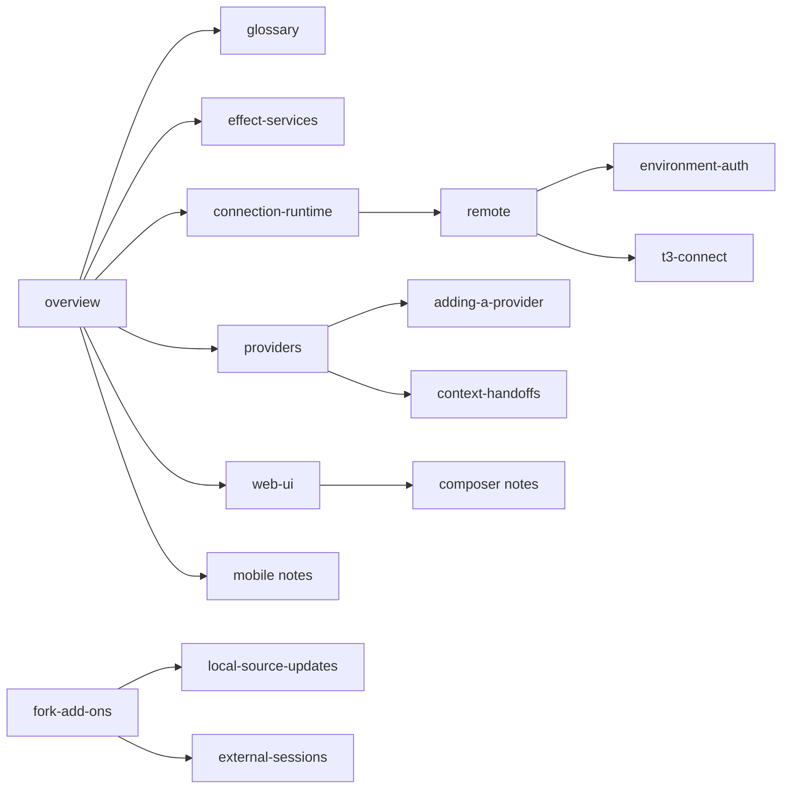

# Internals

Every architecture and implementation note in `docs/internals/`, grouped by area, so a maintainer or agent can find the right constraint in one read.

Up: [docs index](../README.md) · [fork landing page](../../.github/README.md). Not here: how to use a feature ([user guides](../user/README.md)), maintainer procedures ([operations runbooks](#maintainer-runbooks-and-design-sets)), the rules for writing these notes ([documentation rules](../../AGENTS.md#documentation)).

This page belongs to the ndev.t3code fork and is not part of upstream T3 Code. Notes marked _fork add-on_ describe code only the fork has.

## Routes

| Need / keywords                                                       | Open                                                                                                                                                                                                                                                   | Notes                            |
| --------------------------------------------------------------------- | ------------------------------------------------------------------------------------------------------------------------------------------------------------------------------------------------------------------------------------------------------ | -------------------------------- |
| architecture, commands, events, projections, checkpoints              | [overview.md](overview.md)                                                                                                                                                                                                                             | Start here                       |
| terms, vocabulary, thread, turn, environment                          | [glossary.md](glossary.md)                                                                                                                                                                                                                             |                                  |
| Effect services, server features, transports                          | [effect-services.md](effect-services.md)                                                                                                                                                                                                               | Read before adding server code   |
| web UI components, variants, shadcn                                   | [web-ui.md](web-ui.md)                                                                                                                                                                                                                                 |                                  |
| connections, remote environments, auth, relay, T3 Connect             | [connection-runtime.md](connection-runtime.md) · [remote.md](remote.md) · [environment-auth.md](environment-auth.md) · [t3-connect.md](t3-connect.md)                                                                                                  |                                  |
| providers, adapters, adding a provider, model manifest                | [providers.md](providers.md) · [adding-a-provider.md](adding-a-provider.md) · [model-manifest.md](model-manifest.md)                                                                                                                                   |                                  |
| handoffs, forks, V1 to V2 migration                                   | [context-handoffs.md](context-handoffs.md) · [legacy-orchestration-migration.md](legacy-orchestration-migration.md)                                                                                                                                    |                                  |
| composer, Tiptap, context references, citations, voice                | [composer-editors.md](composer-editors.md) · [composer-context-references.md](composer-context-references.md) · [assistant-citations.md](assistant-citations.md) · [voice-input.md](voice-input.md)                                                    |                                  |
| terminal, PTY, simulators, window capture, PR file marks              | [terminal-runtime.md](terminal-runtime.md) · [devices.md](devices.md) · [linux-snap-shot.md](linux-snap-shot.md) · [pull-request-file-revisions.md](pull-request-file-revisions.md)                                                                    |                                  |
| mobile navigation, Expo, HMR                                          | [mobile-navigation.md](mobile-navigation.md) · [mobile-development.md](mobile-development.md)                                                                                                                                                          |                                  |
| server updates, launcher, telemetry, analytics, performance, licenses | [server-updates.md](server-updates.md) · [resource-telemetry.md](resource-telemetry.md) · [product-analytics.md](product-analytics.md) · [performance-regressions.md](performance-regressions.md) · [open-source-licenses.md](open-source-licenses.md) |                                  |
| fork hooks, Fork add-on marker, upstream merges                       | [fork-add-ons.md](fork-add-ons.md) · [local-source-updates.md](local-source-updates.md)                                                                                                                                                                | Fork add-ons                     |
| Other Agents, external sessions, session search, web app tabs         | [external-sessions.md](external-sessions.md) · [session-search.md](session-search.md) · [remote-apps.md](remote-apps.md)                                                                                                                               | Fork add-ons                     |
| session details, context breakdown, MCP server status                 | [session-insights.md](session-insights.md)                                                                                                                                                                                                             | Fork add-on                      |
| orchestration v2 target design                                        | [orchestration-v2/README.md](../orchestration-v2/README.md)                                                                                                                                                                                            | Design set, not current behavior |

## Map

## Contents

### Architecture and conventions

- [Architecture](overview.md): execution model, environments and core constraints.
- [Glossary](glossary.md): shared vocabulary across T3 Code.
- [Effect services](effect-services.md): server features as services behind thin transports.
- [Web UI](web-ui.md): `components/ui` variants and layout rules.
- [Action names](consistency-action-names.md): labels, tooltips and menus must agree.
- [Dev container](devcontainer.md): Linux environment matching CI.

### Connections and environments

- [Connection runtime](connection-runtime.md): one connection owner per environment across clients.
- [Remote architecture](remote.md): clients joining environments over HTTP and WebSocket.
- [Environment authentication](environment-auth.md): environment-issued sessions and capabilities.
- [T3 Connect](t3-connect.md): cloud identity, relay and environment links.
- [Server updates](server-updates.md): stable launcher and runtime updates.

### Providers and orchestration

- [Provider constraints](providers.md): provider-neutral orchestration and adapter duties.
- [Adding a provider](adding-a-provider.md): checklist for an honest new integration.
- [Model manifest](model-manifest.md): bundled model classification.
- [Context handoffs](context-handoffs.md): portable provider and fork handoff summaries.
- [Legacy orchestration migration](legacy-orchestration-migration.md): V1 to V2 database snapshot.

### Composer and messages

- [Composer coordinates and serialization](composer-editors.md): draft Markdown versus Tiptap document.
- [Composer context references](composer-context-references.md): inline typed context payloads.
- [Assistant citations](assistant-citations.md): excerpts and source identity in message text.
- [Voice input](voice-input.md): transcription into a draft, never a turn.

### Workspace features

- [Terminal runtime](terminal-runtime.md): PTYs, session lifetime and retained output.
- [Devices](devices.md): environment-owned simulators and emulators.
- [Linux window capture](linux-snap-shot.md): Wayland capture backends.
- [Pull request file revisions](pull-request-file-revisions.md): viewed-file marks kept by the environment.

### Mobile

- [Mobile navigation](mobile-navigation.md): shared native stack for home and threads.
- [Mobile development lifecycle](mobile-development.md): HMR boundary and native rebuilds.

### Telemetry, performance and licenses

- [Resource telemetry](resource-telemetry.md): Rust process monitor counters.
- [Product analytics](product-analytics.md): server-owned PostHog delivery and opt-out.
- [Performance regression checks](performance-regressions.md): v2 transport regression command.
- [Open source license notices](open-source-licenses.md): per-client generated notices.

### Fork add-ons

- [Fork add-ons](fork-add-ons.md): fork-owned files, one-line hooks, marker check.
- [Local source updates](local-source-updates.md): packaged fork builds updating from their checkout.
- [External sessions](external-sessions.md): Other Agents sessions from outside T3.
- [Session search](session-search.md): searching other agents' session messages.
- [Session insights](session-insights.md): the thread details card's live session report.
- [Desktop remote apps](remote-apps.md): ChatGPT, Claude and other web app tabs.
- [Hermes Agent provider](hermes.md): a remote Hermes over HTTP, its sidebar section and settings.

### Maintainer runbooks and design sets

`docs/operations/` has fewer than ten runbooks, so they are listed here.

- [Development](../operations/development.md): local dev servers, builds and dev credentials.
- [Release checklist](../operations/release.md): release steps.
- [T3 Connect setup](../operations/connect-setup.md): T3 Connect deployment and client configuration.
- [Observability](../operations/observability.md): the server observability model and local trace file.
- [Relay observability](../operations/relay-observability.md): relay trace setup.
- [Android notifications](../operations/android-notifications.md): Android push through Firebase Cloud Messaging.
- [Live background-work verification](../operations/background-verification.md): live check with real provider credentials.
- [Mobile app-store screenshot harness](../operations/mobile-app-store-screenshots.md): store screenshot capture.
- [Building the mobile Screens dependency](../operations/mobile-screens-fork.md): the committed Screens tarball for mobile.
- [Orchestration V2](../orchestration-v2/README.md): target orchestration design documents.
