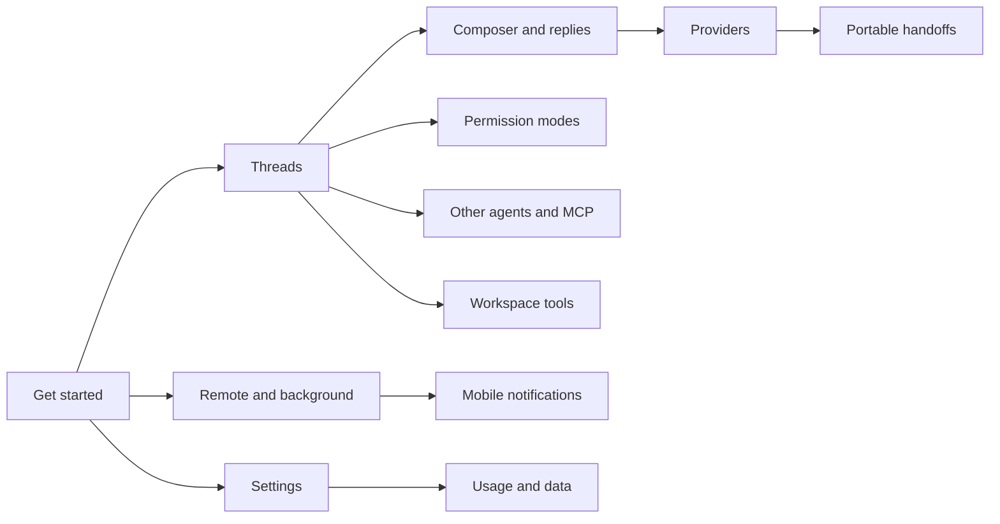

# User guides

Every T3 Code user guide in `docs/user/`, grouped by task, so you can find the right page in one read.

Up: [docs index](../README.md) · [fork landing page](../../.github/README.md). Not here: architecture and implementation notes ([internals](../internals/README.md)), maintainer setup and release runbooks ([operations](../README.md#runbooks)).

This page belongs to the ndev.t3code fork and is not part of upstream T3 Code. Pages marked _fork add-on_ document features only the fork has.

## Routes

| Need / keywords                                                     | Open                                                                                                                                                                  | Notes                       |
| ------------------------------------------------------------------- | --------------------------------------------------------------------------------------------------------------------------------------------------------------------- | --------------------------- |
| install, first run, setup flow, update, upgrade, V1 to V2           | [install.md](install.md) · [welcome-wizard.md](welcome-wizard.md) · [updating.md](updating.md) · [thread-migration.md](thread-migration.md)                           | Start here                  |
| build from source, fork updates, Sync & Build                       | [fork-updating.md](fork-updating.md)                                                                                                                                  | Fork add-on                 |
| fork differences, new thread without a project                      | [fork-behavior.md](fork-behavior.md)                                                                                                                                  | Fork add-on                 |
| threads, worktrees, sidebar, pin, archive                           | [thread-sidebar.md](thread-sidebar.md)                                                                                                                                |                             |
| composer, messages, attach files, mentions, context                 | [composer.md](composer.md) · [question-attachments.md](question-attachments.md)                                                                                       |                             |
| approvals, permission modes, full access                            | [permission-modes.md](permission-modes.md)                                                                                                                            |                             |
| tool call summary, charts and pages in replies, prompt links        | [activity-log.md](activity-log.md) · [html-renders.md](html-renders.md) · [prompt-links.md](prompt-links.md)                                                          |                             |
| session details, context breakdown, MCP servers, connectors         | [session-details.md](session-details.md)                                                                                                                              | Fork add-on                 |
| export thread, save to notes, Markdown, JSON                        | [save-and-export-threads.md](save-and-export-threads.md)                                                                                                              | Fork add-on                 |
| switch provider, handoff, portable context                          | [portable-handoffs.md](portable-handoffs.md)                                                                                                                          |                             |
| Codex, Claude, Cursor, OpenCode, Antigravity, Pi, Muse, ACP         | [providers-codex.md](providers-codex.md) and the other provider pages in [Contents](#providers)                                                                       | One page per provider       |
| Hermes Agent, remote agent, Hermes sessions and config              | [hermes.md](hermes.md)                                                                                                                                                | Fork add-on                 |
| MCP, outside agents, other agent sessions, compare, delegation      | [outside-agents.md](outside-agents.md) · [other-agents.md](other-agents.md) · [compare-agents.md](compare-agents.md) · [agent-instructions.md](agent-instructions.md) | Last three are fork add-ons |
| terminal, git, pull requests, simulators, screenshots               | [terminal.md](terminal.md) · [source-control.md](source-control.md) · [devices.md](devices.md) · [snap-shot.md](snap-shot.md)                                         |                             |
| browser sessions, default browser, ChatGPT and Claude web tabs      | [browser-import.md](browser-import.md) · [default-browser.md](default-browser.md) · [desktop-remote-apps.md](desktop-remote-apps.md)                                  | Web tabs are a fork add-on  |
| settings, project overrides, themes, shortcuts, focus               | [project-settings.md](project-settings.md) · [appearance.md](appearance.md) · [keybindings.md](keybindings.md) · [keyboard-focus.md](keyboard-focus.md)               |                             |
| phone, remote access, T3 Connect, notifications, background service | [remote-access.md](remote-access.md) · [mobile-notifications.md](mobile-notifications.md) · [background-service.md](background-service.md)                            |                             |
| usage limits, telemetry, licenses                                   | [usage.md](usage.md) · [telemetry.md](telemetry.md) · [open-source-licenses.md](open-source-licenses.md)                                                              |                             |

## Map

## Contents

### Get started

- [Install T3 Code](install.md): install, sign in to a provider, first launch.
- [Welcome wizard](welcome-wizard.md): setup flow on a new install or environment.
- [Updating T3 Code](updating.md): updating the app and the server separately.
- [Threads from older versions](thread-migration.md): how V1 threads move into V2.
- [Build and update ndev.t3code](fork-updating.md): fork add-on; build from source and update.
- [Where ndev.t3code differs](fork-behavior.md): fork add-on; upstream features that behave differently.

### Threads and messages

- [Working with threads](thread-sidebar.md): threads, worktrees and the sidebar.
- [Messages and context](composer.md): composer, files, quotes and context.
- [Files in question answers](question-attachments.md): attach files when answering an agent question.
- [Permission modes](permission-modes.md): when an agent needs your approval.
- [Activity log](activity-log.md): expandable summaries of tool calls.
- [Visual replies](html-renders.md): agents answering with charts, tables and pages.
- [Session details](session-details.md): fork add-on; a thread's model, context, MCP servers and changed files.
- [Prompt links](prompt-links.md): links that open T3 Code with a prompt ready.
- [Context in portable handoffs](portable-handoffs.md): context carried across provider switches.
- [Save and export threads](save-and-export-threads.md): fork add-on; export or file a thread.

### Providers

- [Codex](providers-codex.md): ChatGPT plan or Codex CLI login.
- [Claude](providers-claude.md): Claude Code login and configuration.
- [Cursor](cursor.md): Cursor through the official SDK.
- [OpenCode](providers-opencode.md): install and authenticate OpenCode.
- [Antigravity](providers-antigravity.md): Google's Antigravity ACP agent.
- [Pi](providers-pi.md): existing Pi installation, models and auth.
- [Muse Code](providers-muse.md): beta integration, off by default.
- [ACP providers](providers-acp.md): other ACP commands and agents.
- [Hermes Agent](hermes.md): fork add-on; chat with a Hermes Agent over its API.

### Other agents

- [Outside agents](outside-agents.md): agents T3 did not start, over MCP.
- [Sessions from other agents](other-agents.md): fork add-on; follow and continue outside sessions.
- [Compare agents](compare-agents.md): fork add-on; one prompt, two models.
- [Agent instructions](agent-instructions.md): fork add-on; delegation and agent rules as settings.

### Workspace tools

- [Terminal history](terminal.md): terminal scrollback and retention.
- [Source control](source-control.md): git hosts, cloning and pull requests.
- [Devices](devices.md): live iOS Simulator or Android Emulator panel.
- [SnapShots](snap-shot.md): capture a window into the draft.
- [Import browser sessions](browser-import.md): reuse another browser's sign-ins.
- [Default browser](default-browser.md): T3 Code as the macOS default browser.
- [Web apps in ndev.t3code](desktop-remote-apps.md): fork add-on; ChatGPT, Claude and other web tabs.

### Settings and appearance

- [Settings and project overrides](project-settings.md): global settings versus per-project overrides.
- [Appearance and themes](appearance.md): themes and system light or dark.
- [Keybindings](keybindings.md): customize shortcuts.
- [Keyboard focus](keyboard-focus.md): where focus goes after palettes and dialogs.

### Remote and background

- [Remote access](remote-access.md): connect a phone, browser or another desktop.
- [Mobile notifications](mobile-notifications.md): alerts when an agent finishes or needs you.
- [Running in the background](background-service.md): run T3 Code as a user service.

### Usage, data and licenses

- [Usage and limits](usage.md): provider usage and rate limits.
- [Product usage data](telemetry.md): what telemetry is sent and how to opt out.
- [Open source licenses](open-source-licenses.md): third-party license notices.
