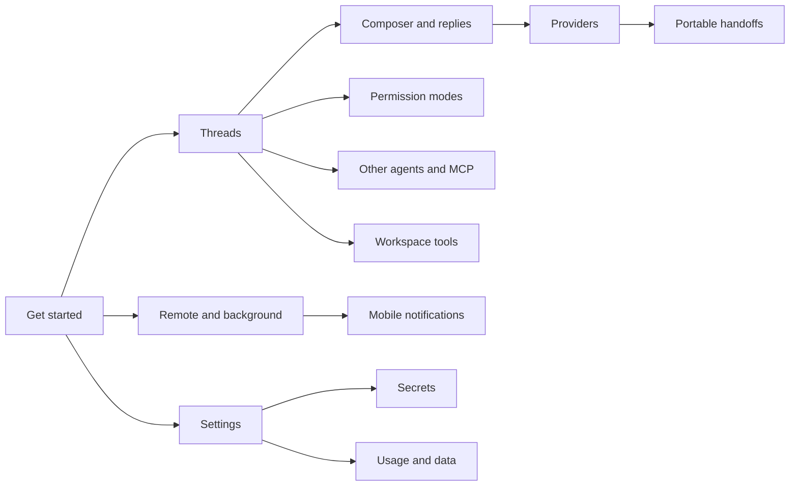

# User guides

Every T3 Code user guide in `docs/user/`, grouped by task, so you can find the right page in one read.

Up: [docs index](../README.md) · [fork landing page](../../.github/README.md). Not here: architecture and implementation notes ([internals](../internals/README.md)), maintainer setup and release runbooks ([operations](../README.md#runbooks), [fork host releases](../operations/fork-host-releases.md)).

This page belongs to the ndev.t3code fork and is not part of upstream T3 Code. Pages marked _fork add-on_ document features only the fork has.

## Routes

| Need / keywords                                                       | Open                                                                                                                                                                                                        | Notes                              |
| --------------------------------------------------------------------- | ----------------------------------------------------------------------------------------------------------------------------------------------------------------------------------------------------------- | ---------------------------------- |
| install, first run, welcome page, update, upgrade, V1 to V2, FAQ      | [install.md](install.md) · [welcome-page.md](welcome-page.md) · [updating.md](updating.md) · [thread-migration.md](thread-migration.md) · [faq.md](faq.md)                                                  | Start here                         |
| build from source, fork updates, Sync & Build, repair agents          | [fork-updating.md](fork-updating.md)                                                                                                                                                                        | Fork add-on                        |
| fork differences, reporting problems, small fork add-ons              | [fork-behavior.md](fork-behavior.md)                                                                                                                                                                        | Fork add-on                        |
| threads, worktrees, sidebar, pin, archive, several repositories       | [thread-sidebar.md](thread-sidebar.md) · [multi-repo-projects.md](multi-repo-projects.md)                                                                                                                   |                                    |
| composer, messages, attach files, mentions, context, dictation        | [composer.md](composer.md) · [question-attachments.md](question-attachments.md) · [voice-input.md](voice-input.md)                                                                                          |                                    |
| approvals, permission modes, full access                              | [permission-modes.md](permission-modes.md)                                                                                                                                                                  |                                    |
| tool call summary, charts and pages in replies, prompt links          | [activity-log.md](activity-log.md) · [html-renders.md](html-renders.md) · [prompt-links.md](prompt-links.md)                                                                                                |                                    |
| session details, context breakdown, MCP servers, connectors           | [session-details.md](session-details.md)                                                                                                                                                                    | Fork add-on                        |
| export thread, save to notes, Markdown, JSON                          | [save-and-export-threads.md](save-and-export-threads.md)                                                                                                                                                    | Fork add-on                        |
| share a thread, guest links                                           | [guest-links.md](guest-links.md)                                                                                                                                                                            |                                    |
| switch provider, handoff, portable context                            | [portable-handoffs.md](portable-handoffs.md)                                                                                                                                                                |                                    |
| Codex, Claude, Cursor, OpenCode, Antigravity, Pi, Muse, Kiro, fx, ACP | [providers-codex.md](providers-codex.md) and the other provider pages in [Contents](#providers)                                                                                                             | One page per provider              |
| titles, commit messages, text generation model                        | [text-generation.md](text-generation.md)                                                                                                                                                                    |                                    |
| Hermes Agent, remote agent, Hermes sessions and config                | [hermes.md](hermes.md)                                                                                                                                                                                      | Fork add-on                        |
| OpenBot agents, OpenBot conversations, Local scripts                  | [openbot.md](openbot.md)                                                                                                                                                                                    | Fork add-on                        |
| MCP, outside agents, other agent sessions, compare, delegation        | [outside-agents.md](outside-agents.md) · [mcp-hub.md](mcp-hub.md) · [other-agents.md](other-agents.md) · [compare-agents.md](compare-agents.md) · [agent-instructions.md](agent-instructions.md)            | All but the first are fork add-ons |
| workflows, multi-step runs, triage a T3 Code problem                  | [workflows.md](workflows.md) · [triage.md](triage.md)                                                                                                                                                       |                                    |
| terminal, git, pull requests, simulators, screenshots                 | [terminal.md](terminal.md) · [source-control.md](source-control.md) · [devices.md](devices.md) · [snap-shot.md](snap-shot.md)                                                                               |                                    |
| browser sessions, default browser, ChatGPT and Claude web tabs        | [browser-import.md](browser-import.md) · [default-browser.md](default-browser.md) · [desktop-remote-apps.md](desktop-remote-apps.md)                                                                        | Web tabs are a fork add-on         |
| settings, project overrides, themes, shortcuts, focus, managed policy | [project-settings.md](project-settings.md) · [appearance.md](appearance.md) · [keybindings.md](keybindings.md) · [keyboard-focus.md](keyboard-focus.md) · [managed-policy.md](managed-policy.md)            |                                    |
| secrets, password manager, 1Password                                  | [secrets.md](secrets.md) · [secrets-1password-service-account.md](secrets-1password-service-account.md) · [secrets-1password-connect.md](secrets-1password-connect.md)                                      |                                    |
| phone, remote access, T3 Connect, notifications, background service   | [remote-access.md](remote-access.md) · [t3-connect-troubleshooting.md](t3-connect-troubleshooting.md) · [mobile-notifications.md](mobile-notifications.md) · [background-service.md](background-service.md) |                                    |
| usage limits, telemetry, licenses                                     | [usage.md](usage.md) · [telemetry.md](telemetry.md) · [open-source-licenses.md](open-source-licenses.md)                                                                                                    |                                    |

## Map

## Contents

### Get started

- [Install T3 Code](install.md): install, sign in to a provider, first launch.
- [Welcome page](welcome-page.md): what T3 Code found on a new install.
- [Updating T3 Code](updating.md): updating the app and the server separately.
- [Threads from older versions](thread-migration.md): how V1 threads move into V2.
- [FAQ](faq.md): common questions about what T3 Code is and does.
- [Build and update ndev.t3code](fork-updating.md): fork add-on; build from source and update.
- [Where ndev.t3code differs](fork-behavior.md): fork add-on; what differs from upstream, where to report problems, and small add-ons without their own page.

### Threads and messages

- [Working with threads](thread-sidebar.md): threads, worktrees and the sidebar.
- [Projects with several repositories](multi-repo-projects.md): one thread across several repositories.
- [Messages and context](composer.md): composer, files, quotes and context.
- [Voice input](voice-input.md): dictate into the composer and comments.
- [Files in question answers](question-attachments.md): attach files when answering an agent question.
- [Permission modes](permission-modes.md): when an agent needs your approval.
- [Activity log](activity-log.md): expandable summaries of tool calls.
- [Visual replies](html-renders.md): agents answering with charts, tables and pages.
- [Session details](session-details.md): fork add-on; a thread's model, context, MCP servers and changed files.
- [Prompt links](prompt-links.md): links that open T3 Code with a prompt ready.
- [Context in portable handoffs](portable-handoffs.md): context carried across provider switches.
- [Save and export threads](save-and-export-threads.md): fork add-on; export or file a thread.
- [Guest links](guest-links.md): let a teammate follow one thread in their browser.
- [Text generation models](text-generation.md): the model that writes titles, commit messages and branch names.

### Providers

- [Codex](providers-codex.md): ChatGPT plan or Codex CLI login.
- [Claude](providers-claude.md): Claude Code login and configuration.
- [Cursor](cursor.md): Cursor through the official SDK.
- [OpenCode](providers-opencode.md): install and authenticate OpenCode.
- [Antigravity](providers-antigravity.md): Google's Antigravity ACP agent.
- [Pi](providers-pi.md): existing Pi installation, models and auth.
- [Muse Code](providers-muse.md): beta integration, off by default.
- [Kiro](providers-kiro.md): the Kiro CLI with your own Kiro account.
- [fx](providers-fx.md): fx with the server machine's login.
- [ACP providers](providers-acp.md): other ACP commands and agents.
- [Hermes Agent](hermes.md): fork add-on; chat with a Hermes Agent over its API.
- [OpenBot](openbot.md): fork add-on; chat with OpenBot agents and follow their conversations.

### Other agents

- [Outside agents](outside-agents.md): agents T3 did not start, over MCP.
- [MCP hub](mcp-hub.md): fork add-on; connect OAuth, header-only, and stdio agents with revocable access.
- [Sessions from other agents](other-agents.md): fork add-on; follow and continue outside sessions.
- [Compare agents](compare-agents.md): fork add-on; one prompt, two models.
- [Agent instructions](agent-instructions.md): fork add-on; delegation, worker models and agent rules as settings.
- [Workflows](workflows.md): early feature; scripted multi-step runs that survive restarts.
- [Triage an issue](triage.md): let your agent investigate a T3 Code problem.

### Workspace tools

- [Terminal history](terminal.md): terminal scrollback and retention.
- [Source control](source-control.md): git hosts, cloning and pull requests.
- [Devices](devices.md): live iOS Simulator or Android Emulator panel.
- [SnapShots](snap-shot.md): capture a window into the draft.
- [Import browser sessions](browser-import.md): reuse another browser's sign-ins.
- [Default browser](default-browser.md): T3 Code as the macOS default browser.
- [Web apps in ndev.t3code](desktop-remote-apps.md): fork add-on; ChatGPT, Claude and other web tabs.

### Settings and appearance

- [Settings and project overrides](project-settings.md): global settings versus per-project overrides.
- [Appearance and themes](appearance.md): themes and system light or dark.
- [Keybindings](keybindings.md): customize shortcuts.
- [Keyboard focus](keyboard-focus.md): where focus goes after palettes and dialogs.
- [Managed policy](managed-policy.md): administrator defaults, locks and limits for a machine.

### Secrets

- [Secrets](secrets.md): read credentials from a password manager, and secret requests from agents.
- [1Password service account](secrets-1password-service-account.md): 1Password on a headless or remote server.
- [1Password Connect](secrets-1password-connect.md): read secrets through your own Connect server.

### Remote and background

- [Remote access](remote-access.md): connect a phone, browser or another desktop.
- [T3 Connect troubleshooting](t3-connect-troubleshooting.md): find which part of a T3 Connect connection fails.
- [Mobile notifications](mobile-notifications.md): alerts when an agent finishes or needs you.
- [Running in the background](background-service.md): run T3 Code as a user service.

### Usage, data and licenses

- [Usage and limits](usage.md): provider usage and rate limits.
- [Product usage data](telemetry.md): what telemetry is sent and how to opt out.
- [Open source licenses](open-source-licenses.md): third-party license notices.
